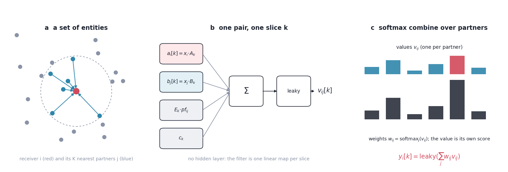
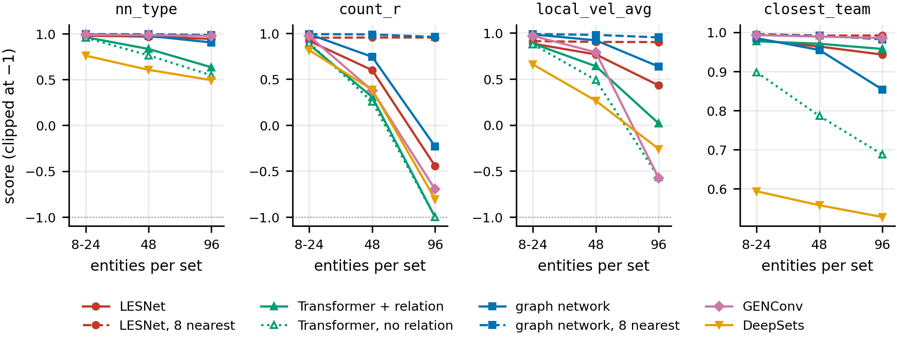
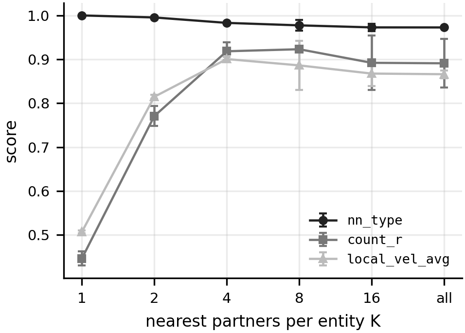
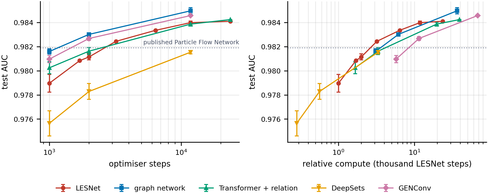
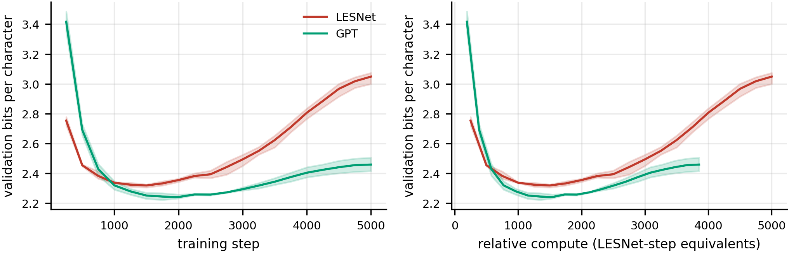
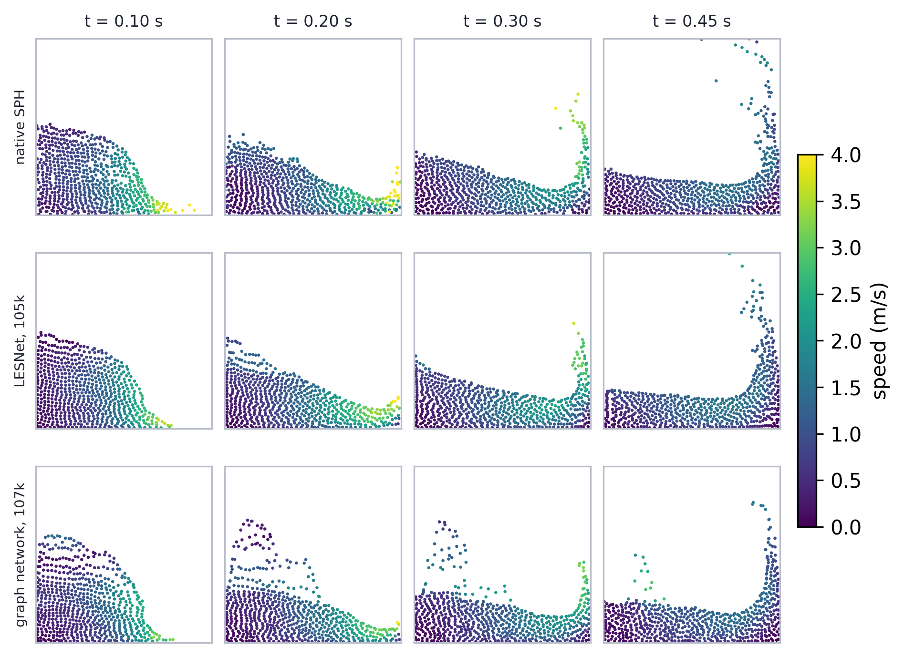
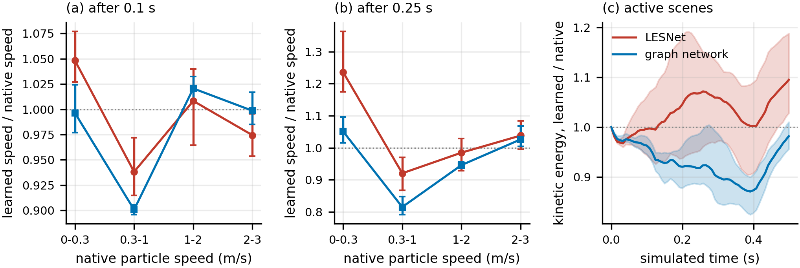
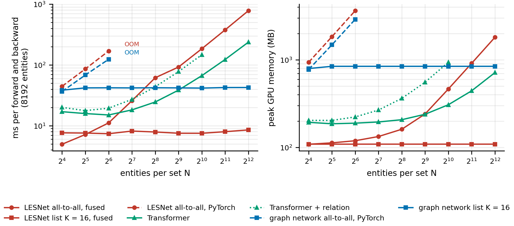
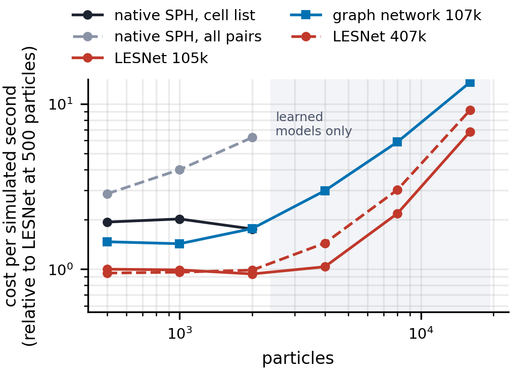

# LESNet: a linear pair filter with a softmax combine for sets of interacting entities

*Lester · Independent Researcher · lesterbark@gmail.com*

## Abstract

LESNet (Leaky Entity Softmax Network) is a layer for sets of entities whose cardinality varies and whose pairwise relations, such as relative positions, are supplied as input. For each entity and each of `W` output slices, it applies a single linear filter to the receiver, a partner and their relation, passes the result through a leaky ReLU, and takes a per-slice soft maximum over the partners. We show that the layer is permutation equivariant, that a slice ranks a receiver's partners independently of the receiver's own features except through the relation, that the output depends on the partners only through their normalised distribution, and that a slice approaches a max-plus operator in its sharp limit and a leaky-rectified mean of the pair values in its diffuse limit. Fused CUDA kernels for both all-to-all and neighbour-list partner layouts avoid materialising the pair tensor and match a float64 PyTorch oracle to within 2×10⁻⁶ in values and gradients.

We evaluate LESNet on seven synthetic relational tasks, top-quark jet tagging, MNIST point sets, citation graphs, CIFAR-10 pixels, character-level language modelling and a learned 2-D fluid simulator, comparing each against baselines matched in parameter count. At equal parameters and optimiser steps, LESNet trails a message-passing graph network and GENConv (softmax message aggregation) on top-quark tagging (by 0.0015 to 0.0026 AUC after 1000 and 2000 steps, where LESNet reaches 0.9790 and 0.9811, and by 0.0010 against the graph network after 11 800 steps) and on four and five of the seven synthetic tasks, respectively. Against a Transformer given the same relation vector, it scores higher on three synthetic tasks and lower on one, and on jets it trails after 1000 steps before matching within 95% confidence intervals at 2000 and 11 800 steps. On MNIST point sets its accuracy is within error bars of both the graph network and the Transformer, and as a learned fluid simulator its rollout errors over four training seeds do not separate from those of a parameter-matched graph-network simulator. On citation graphs, CIFAR-10 pixels and character-level text it lags the standard architectures. Training-step costs and equal-compute jet comparisons are reported in §8 as ratios measured on one Turing GPU.

## 1. Introduction

Many learning problems are about a *set of interacting entities* rather than a grid or a sequence: the
players and ball of a game or the particles of a fluid. The
target often depends on *relationships* rather than on one entity alone, such as which other entity is nearest or the mean velocity of a particle's neighbours. We call this the **entity regime**: tens to a few thousand entities, each with a feature vector
and a position, no fixed order, and a number that changes from one example to the next.

Established models address parts of that regime.

* **Convolutional networks** apply a learned filter at every position of a regular grid, within a local window.
* **Graph networks** let entities exchange messages along edges, usually chosen by distance, and aggregate the messages (by a mean, for example) before a node update. The graph is built before the network runs.
* **Transformers** let every entity attend to every other. Attention is a scalar score per pair and head followed by a read of the partner's own value; the relation between two entities (their relative position, say) enters through position encodings or an attention bias, and the cost is quadratic in the number of entities unless the attention is restricted.

In a graph network the pair step is a multilayer perceptron; in a Transformer the relation enters only the score, and the value read from a partner does not depend on the receiver. This paper studies a pair step at the other extreme: a single linear map of receiver, partner and relation, followed by a per-channel soft maximum over the partners.

**LESNet** (Leaky Entity Softmax Network) is a layer of this kind. One layer does three
things for every entity `i` and every slice `k` of its output:

1. a **linear pair filter**: `z_ij = a_i + b_j + pf_ij E + c`, where `a_i` and `b_j` are linear in the two
   entities' features and `pf_ij` is the *relation* between them (relative position, distance,
   direction), supplied as data;
2. a **leaky ReLU** (Maas et al., 2013), giving one value `v_ij` per partner `j`;
3. a **softmax combine**: `y_i = leaky(Σ_j softmax_j(v_ij) · v_ij)`, a soft maximum over partners,
   computed separately for every slice.

The pair step is a single linear map and an activation; there is no query/key/value split, no positional encoding and no
normalisation layer. Each slice learns one linear test on `(x_i, x_j, pf_ij)`
and then weights the partners by how strongly they pass it. The width (the number of slices) is the size parameter of a layer. Because the partners of an entity are a list, the same layer runs all-to-all or
on each entity's `K` nearest neighbours within a radius.

**Contributions.**

* The layer and its analysis (§3): each slice acts as a one-dimensional attention head whose score and value are the same pair-dependent quantity; within a slice the receiver's features do not change the partner ranking except through the relation; the output depends on the partners only through their normalised distribution; and a slice has closed-form sharp (max-plus) and diffuse (rectified mean) limits.
* A fused CUDA implementation (§4) for both partner layouts. It never materialises the pair tensor, is verified against a PyTorch oracle in values and every gradient, and comes with an exact grid neighbour search.
* A controlled study on seven synthetic relational tasks with exact targets (§5): nine models at matched parameter count and three seeds, ablations of the relation vector and the nonlinearity, locality, capacity, and sets larger than those seen in training.
* Real-data benchmarks (§6): top-quark jet tagging and MNIST as a point set (variable-size sets with geometric relations), citation-graph node classification (a given graph, no geometry), CIFAR-10 with pixels as entities against a convolutional network, and character-level language modelling against a small GPT.
* A learned particle-fluid simulator compared with the SPH solver that generated its data and with a graph-network simulator (§7), including a calm-down test and an analysis by particle speed.
* Cost measurements for the layer and comparison models, reported as ratios on one GPU (§8).

Across these benchmarks, the results map out both the reach and the limits of a single-linear pair filter. On geometric sets, LESNet trails a message-passing graph network and GENConv at matched parameters and steps (most visibly on graded local averages and counts), while holding its own against a relation-biased Transformer on several tasks and matching a graph-network fluid simulator in rollout error. On graphs without geometry, regular pixel grids and character sequences, specialised baselines stay clearly ahead.

## 2. Related work

**Interaction and relation networks.** Interaction Networks (Battaglia et al., 2016) and Relation
Networks (Santoro et al., 2017) apply a shared function to every pair of objects and *sum* the results;
the pair function is a multilayer perceptron. LESNet shares the all-pairs, shared-filter structure but
(i) replaces the pair MLP with one linear map and an activation, (ii) replaces the sum by a per-slice
soft maximum, and (iii) feeds the relation `pf_ij` in explicitly.

**Message passing on graphs.** Message-passing neural networks (Gilmer et al., 2017) on a complete
graph with edge features contain the layer as a special case. Softmax aggregation of messages appears
in DeeperGCN (Li et al., 2020) and attention-weighted aggregation in graph attention networks
(Veličković et al., 2018; Brody et al., 2022); principal neighbourhood aggregation (Corso et al., 2020)
combines several aggregators. The softmax aggregator of DeeperGCN weights each channel of a message by a softmax of that same channel, so its message is also its own score. LESNet forms the message from receiver, partner and relation with one linear map and a leaky ReLU, and has no node-update network.

**Set functions.** Deep Sets (Zaheer et al., 2017) and PointNet (Qi et al., 2017) process entities
independently and pool; they have no pairwise term. The Set Transformer (Lee et al., 2019) adds attention.
We use a Deep Sets variant with a pooled context as a baseline.

**Attention.** In a Transformer (Vaswani et al., 2017) the weight of partner `j` for entity `i` is a
softmax over scalar scores `q_i·k_j`, and the output reads the partner's value `v_j`, which does not depend
on `i`. §3.3 shows each LESNet slice is an attention head whose value is pair-dependent and doubles as
its score. Fused attention kernels that never store the score matrix (Dao et al., 2022) are the closest
engineering precedent for §4; the online-softmax recurrence we use is that of Milakov and Gimelshein (2018).

Attention that does not rest on the query-key product has been studied: Synthesizer
(Tay et al., 2021) generates the attention weights from each token alone, or learns them as free parameters. In LESNet the weights depend on the pair through an additive filter and the value is pair-dependent.

**Point sets and jets.** Dynamic Graph CNN (Wang et al., 2019) builds a nearest-neighbour graph and applies an
edge function with a hidden layer to each neighbour pair; ParticleNet (Qu and Gouskos, 2020) applies it to particle
jets and is a standard strong model on the top-tagging benchmark used in §6.1, with Energy Flow Networks / Particle Flow
Networks (Komiske et al., 2019), a Deep Sets variant, as the usual lightweight baseline. Our graph-network baseline is
in this family: nearest neighbours, a pair function with a hidden layer, mean aggregation.

**Real-data baselines.** Convolutional networks are the model for regular grids (LeCun et al., 1998; CIFAR-10: Krizhevsky, 2009); graph convolutional and graph attention networks (Kipf and Welling, 2017; Veličković et al., 2018) are the
standard models for node classification on citation graphs (the Planetoid split: Yang et al., 2016); small autoregressive Transformers (Radford et al., 2019) are the standard models for character-level language modelling.

**Learned physics.** Graph-network simulators (Sanchez-Gonzalez et al., 2020), DPI-Net (Li et al., 2019)
and continuous-convolution fluid networks (Ummenhofer et al., 2020) learn particle dynamics from
simulation. SchNet (Schütt et al., 2017) and equivariant graph networks (Satorras et al., 2021) pass
pairwise distances or relative coordinates into the pair step, as `pf_ij` does here. Our fluid
experiment follows the graph-network-simulator recipe (noise-injected one-step training, autoregressive
rollout) and uses smoothed-particle hydrodynamics (Monaghan, 1992) as the reference solver.

## 3. The LESNet layer

### 3.1 Definition

A layer maps a set of up to `N` entities with features `x_i ∈ R^C` to `y_i ∈ R^W`. For every ordered pair `(i, j)`
with `j` in the partner set `𝒫(i)` it is given a *relation vector* `pf_ij ∈ R^P` describing entity `j` as
seen from entity `i`. The parameters are `A, B ∈ R^{C×W}`, `E ∈ R^{P×W}` and `c ∈ R^W`. For each slice
`k = 1..W`, with `a_i = x_i A` and `b_j = x_j B`:

```
z_ij[k] = (x_i A)[k] + (x_j B)[k] + (pf_ij E)[k] + c[k]       pair filter (one linear map)
v_ij[k] = leaky(z_ij[k])                                      slope 0.1
w_ij[k] = exp(v_ij[k]) / Σ_{j' ∈ 𝒫(i)} exp(v_ij'[k])          softmax over the partners, per slice
y_i[k]  = leaky( Σ_{j ∈ 𝒫(i)} w_ij[k] · v_ij[k] )             softmax combine
```



**Figure 1.** One LESNet slice. (a) A receiver (red) and its partners (blue). (b) The pair value is one linear map of the receiver's features, the partner's features and the relation, followed by a leaky ReLU. (c) The weights are the softmax of the values over the partners; the slice output is the weighted sum of the values passed through a leaky ReLU.

An entity with no valid partner outputs zero. In the all-to-all layout, `𝒫(i)` is the set of all valid entities other than `i`; custom partner lists may include `i` itself when a task calls for it (§6.3, §6.4). A network is a stack of layers; the output has shape `(N, W)` and feeds a task head (a linear layer per entity, or a pooled readout for a set-level target). `x_i A` and `x_j B` are computed once per entity (`O(NCW)`); per `(i, j, k)` the pair step sums them, adds the relation term (`P` multiply-adds) and applies one activation.

### 3.2 Properties

**Permutation equivariance.** `𝒫(i)` is a set and both the softmax and the sum run over it, so
reordering the entities reorders the output and changes nothing else. (With neighbour lists this holds
when the lists are built from geometry, up to ties.)

**Variable set size.** `N` is the maximum set size. A boolean mask marks which slots hold an
entity; masked slots are never partners, never receive and stay exactly zero, so the rows of one batch may hold different
numbers of entities.

**Cost.** All-to-all: `O(N²W)` per layer. With neighbour lists of length `K`: `O(NKW)`. Memory is
`O(NW)` with the fused kernel and neighbour lists (plus `O(NKP)` for the relation vectors), against `O(N²W)` for a direct implementation. The all-to-all layout additionally holds the relation tensor, `O(N²P)`.

**Translation invariance.** The pair filter depends on positions only through `pf`. If `pf` is built from coordinate differences and the entity features exclude absolute coordinates, the layer is invariant to translating all positions.

### 3.3 Relation to attention, and what a slice can select

Multi-head attention computes, per head, `Σ_j softmax_j(s_ij) u_j` with a scalar score `s_ij = q_i·k_j` and
a value `u_j` that depends on the partner only. A LESNet slice is the same recipe with a head of
dimension one in which the score and the value are one quantity, `v_ij[k]`, and that quantity
depends on the pair. There are `W` such heads per layer.

Because leaky ReLU is strictly increasing, the ranking of the partners `j` by `v_ij[k]` is the ranking by
`z_ij[k]`, and `(x_i A)[k]` is the same for every `j`:

> For a fixed receiver `i`, the order in which slice `k` ranks its partners is the order of
> `(x_j B)[k] + (pf_ij E)[k]`. It does not depend on `x_i`.

The receiver's own features set how sharply the softmax concentrates (they shift `z` across the
leaky ReLU's kink) and how large the output is. Selection is driven by the partner's features
and by the relation. Without a relation vector, every receiver ranks its partners identically within a
slice (by `x_j B` alone), so a single slice cannot rank its partners by their relation to the receiver from
absolute coordinates. This is the role of `pf`; §5.3 measures the effect of removing it.

### 3.4 What one layer computes: the sharp and the diffuse limit

Let `z_ij = (x_i A)[k] + (x_j B)[k] + (pf_ij E)[k] + c[k]` be the pair filter of one slice. Leaky ReLU is positively homogeneous, so scaling the parameters of the slice by `λ > 0` scales `v` by `λ`. The limits `λ → ∞` and `λ → 0` have closed forms.

**Sharp limit.** As `λ → ∞` the softmax weights concentrate on the partner with the largest `v`, and since leaky ReLU is increasing the largest `v` belongs to the largest `z`:

```
y_i[k] / λ  →  φ( (x_i A)[k] + c[k] + max_{j ∈ 𝒫(i)} [ (x_j B)[k] + (pf_ij E)[k] ] ),     φ = leaky ∘ leaky.
```

The slice is a max-plus operator over the partners: a maximum of terms that are linear in the partner's features and in the relation, shifted by a term that depends on the receiver alone. A maximum is not a sum: the limit cannot accumulate contributions from several partners. The entity features `x_i` and `x_j` also never multiply each other inside the pair filter, which is a sum of a receiver term, a partner term and a relation term.

**Diffuse limit.** As `λ → 0` the weights become uniform and the combine `s_i[k] = Σ_j w_ij[k] v_ij[k]` expands as the mean `(1/|𝒫(i)|) Σ_j v_ij[k]` of the leaky pair values plus their variance over the partners (of order `λ²`, while the mean is of order `λ`), up to `O(λ³)`. Passing through the outer activation gives `y_i[k] / λ → leaky((1/|𝒫(i)|) Σ_j v_ij[k])`. The trained scale of a slice's parameters places it between the two limits, and a layer can contain slices of both kinds.

**Multiplicity.** At every scale the combine is `E_μ[e^v v] / E_μ[e^v]`, where `μ` is the empirical distribution of the partners' `(x_j, pf_ij)`, so the output depends on the partner multiset only through its normalised distribution. In particular, if every partner is repeated `m` times,

```
Σ_j m·e^{v_j} v_j / Σ_j m·e^{v_j}  =  Σ_j e^{v_j} v_j / Σ_j e^{v_j},
```

so `y_i[k]` is unchanged. A slice reports which kinds of partners are present and with what share; the number of partners is not an input. For lists of exactly `K` partners a share determines a count; for all-to-all sets `|𝒫(i)|` varies with the set size, so a layer is not a counting operator in general (counting targets are measured in §5.1).

### 3.5 Gradients

Let `s_i[k] = Σ_j w_ij[k] v_ij[k]` be the combine, so that `y_i = leaky(s_i)`, and let `g_i` be the gradient of the loss with respect to `s_i`. For the pre-activation, `dz_ij = g_i · w_ij (1 + v_ij − s_i) · leaky'(z_ij)`, and
`∇a_i = Σ_j dz_ij`, `∇b_j = Σ_i dz_ij`, `∇E = Σ_ij pf_ij ⊗ dz_ij`, `∇c = Σ_ij dz_ij`. The kernel's backward
pass computes this directly, recomputing `z_ij` instead of storing it. The relation `pf` is treated as data and
receives no gradient. Because every valid partner has positive weight and `leaky'` is non-zero everywhere (taking the subgradient `0.1` at `z_ij = 0`), whenever `g_i ≠ 0` every partner receives a non-zero gradient except where `1 + v_ij = s_i`. Note that `1 + v_ij − s_i` changes sign when `v_ij < s_i − 1`, since increasing a low-scoring partner's value raises its softmax weight and pulls the weighted average `s_i` down.

### 3.6 Relation features

`pf_ij` is built from coordinate differences (`dx = x_i − x_j`, `dy = y_i − y_j`, with `r = max(√(dx² + dy²), 10⁻⁶)` so coincident entities give zero direction rather than `0/0`) and is a configuration choice: `pos` = `(dx, dy)`,
`axis` = `(|dx|, |dy|)`, `dist` = `r`, `dir` = `(dx/r, dy/r)`. Direction and distance are bundled as `polar` because either alone leaves one-slice questions unanswerable: distance alone does not identify the
direction of a partner, and direction alone does not identify its distance. Direction is given as
`(cos, sin)`, so there is no wrap-around and no implied order. Any tensor of
relations can be used instead (a graph's edge attributes, an offset in a sequence). The kernels accept up to eight relation components.

### 3.7 Neighbour lists

For each receiver the list holds up to `K` partners: its `K` nearest valid entities, optionally only
those within a radius. The filter and the combine are unchanged; the list changes the partner set and the cost, and the layer uses distance only if `pf` contains it. Lists may also point at a different
set of entities than the receivers (senders that never receive, such as fixed scenery).

## 4. Implementation

### 4.1 A fused kernel that never stores the pair tensor

A direct implementation materialises `z`, `v` and the softmax weights, each of shape (batch, `N`, `N`, `W`): 68.7 GB (64 GiB) per
tensor for one set with `N=4096, W=1024` in fp32. The
kernel instead walks each receiver's partners once and keeps a running softmax per slice, the
*online* recurrence `m' = max(m, v)`, `ℓ' = ℓ·e^{m−m'} + e^{v−m'}`, `u' = u·e^{m−m'} + v·e^{v−m'}`, and writes
only the combine `s_i = u/ℓ` (before the outer leaky ReLU) together with `m` and `ℓ`, which the backward pass needs. One thread owns one slice, so
partners are read as coalesced rows of `b`. Exactly one of the two rescaling factors is `e^0`, so one
`__expf(-|m-v|)` serves both.

There are two partner layouts in one file (`lesnet_cuda/kernels.py`):

* **all-to-all.** One block walks `TI` receivers of one set against all partners; the partner loop is outer
  and the receiver loop inner, so each partner row `b_j` is loaded once for the whole tile, and the tile's
  pair features are staged in shared memory whenever the tile fits within 48 KB (`TI · N · P · 4 ≤ 48 KB`, falling back to global loads for larger `N`). The default tile sizes are `TI=8` forward and `TI=4` backward.
* **list.** A receiver names its `K` partner rows (`-1` = none). The index is the same for every thread of
  the block, so the branch is warp-uniform; the partner row is a coalesced gather. One block handles one receiver (`TI=1`). The backward scatters
  `∇b` with atomic adds, which coalesce across a warp's adjacent slices.

The packed projection `ab = x·[A | B]` is one matrix multiply, so a layer is three matrix multiplies in total (one forward, two backward) plus one kernel in each direction. The relation width `P` is a runtime value up to 8; widths 4, 6 and 8 use
vector loads in the forward pass, and widths 4 and 8 use `float4` loads in the backward pass.

### 4.2 Verification

Full multi-layer networks (both all-to-all and list layouts, including receivers distinct from senders) are checked against a float64 PyTorch oracle that materialises every tensor, verifying forward values and every parameter and input gradient (`lesnet_cuda/tests.py`). A second kernel-level shape suite (`lesnet_cuda/tests_sizes.py`) checks the raw kernels against a float32 PyTorch reference across ragged `N` and `W`, masked entities, empty receivers, relation widths `P ∈ {1, 3, 4, 5, 6, 7, 8}`, widths above the thread-block limit, and `N` up to 512 (all-to-all) and 4096 (list).

**Table 1.** Worst-case agreement of the fused CUDA layers with the PyTorch reference (`tests.py`: relative error against a float64 oracle; `tests_sizes.py`: all-to-all forward is max absolute error against a float32 reference, gradients are relative; list layout reports one worst relative error across forward and all gradients in both columns).

| suite | cases passed | max forward error | max gradient error |
|---|---|---|---|
| network-level checks (`tests.py`) | 25 | 7.3e-07 | 1.9e-06 |
| kernel size suite, all-to-all (`tests_sizes.py`) | 18 | 1.8e-06 | 1.3e-06 |
| kernel size suite, list layout | 14 | 1.7e-06 | 1.7e-06 |

Forward values and every gradient agree with the float64 oracle to within 2×10⁻⁶ relative, and with the float32 shape suite to under 2×10⁻⁶ (Table 1). The properties of §3.2 and §3.4 are asserted as well: permutation equivariance (5e-7), padded rows reproducing each row run alone (4e-7), the list layout equal to the all-to-all layout when every other entity is listed (3e-7), the grid neighbour search returning exactly the brute-force lists, and invariance to repeating every partner three times (1e-7).

### 4.3 Neighbour search

`neighbors.knn_neighbors` returns each entity's `K` nearest valid partners, nearest first, optionally
only those within a radius, with masks for absent entities and no self-pairs. Two exact searches sit
behind it. **Brute force**: a (batch, `R`, `S`) distance matrix per row chunk and a top-`K`; `O(N²)`. **Grid** (used whenever a radius is given): the
entities are sorted into a uniform grid whose cell edge is the radius (a sort and a `searchsorted` in
PyTorch) and a CUDA kernel, one thread per receiver, scans the 3×3 cells around its own, keeping the `K`
nearest candidates in a small sorted array; `O(N)` at bounded density. The grid search is tested to return
*exactly* the lists a float64 brute-force search returns (including masked entities, tiny radii and `K` close
to `N`). The layer only consumes the (batch, `N`, `K`) index tensor, however it was made.

### 4.4 Numerics and hardware

Computation is in fp32 with `--use_fast_math`. The kernels are written for CUDA cores and do not use tensor cores. All measurements in this paper are on one NVIDIA GTX 1660 Ti (Turing, sm_75, 24
SMs, 6 GB) with an Intel i7-10750H, PyTorch 2.4.1 / CUDA 12.4 and nvcc 12.9. The
backward uses floating-point atomics, so gradients are reproducible only up to summation order.

## 5. Experiments on synthetic entity tasks

### 5.0 Protocol

**Worlds.** Each example is a set of `n` entities (`n` drawn uniformly from 8-24, padded to 24 with a
mask) in a square whose side grows as `√n`, so the density stays at about 16 entities per unit area for
any `n`. An entity has a one-hot type (A, B or C; exactly one entity, the "ball", is type A), a 2-d
velocity feature and a position. Local tasks therefore mean the same thing at `n = 16` and `n = 96`, which
is what makes the out-of-distribution-size test (train on 8-24, test on exactly 48 and 96) unambiguous.

**Tasks** (targets are exact functions of the world; data are generated on the GPU, fresh every step):

| task | target | kind | probes |
|---|---|---|---|
| `nn_type` | type of my nearest other entity | per-entity, 3 classes | local, relational, argmin-like |
| `count_r` | number of entities within 0.25 of me | per-entity regression | **counting** |
| `rank_ball` | number of entities closer to the ball than I am | per-entity regression | rank (a count of comparisons) |
| `closest_team` | team (B or C) of the entity nearest the ball | set-level, 2 classes | global argmin |
| `exist_pair` | is any B within 0.07 of any C | set-level, 2 classes | global existence (max-like) |
| `local_vel_avg` | mean velocity of entities within 0.3 of me | per-entity regression (2-d) | local smoothing, as in SPH |
| `nbody_acc` | softened gravity from all other entities | per-entity regression (2-d) | **superposition**: a sum over all pairs |

Classification is scored by accuracy, regression by R² over valid entities (higher is better for both). Regression targets `count_r`, `rank_ball` and `nbody_acc` are linearly scaled by fixed constants (1/4, 1/6 and 1/4) for training stability, which does not change R²; for `local_vel_avg`, entities with no partner within 0.3 have target zero.
For `nbody_acc` the acceleration of entity `i` is `Σ_j m_j (r_j − r_i) / (|r_j − r_i|² + ε²)^{3/2}` with softening `ε = 0.2`, the ball having mass 4 and every other entity mass 1. At the density of the worlds (16 entities per unit area, median nearest-neighbour distance 0.13) an entity has on average 1.6 partners within `ε`. The forces of the 1, 2, 3, 5 and 8 nearest partners alone explain R² = 0.16, 0.33, 0.47, 0.68 and 0.85 of the target, and a linear function of the entity's position and the centroid of the set explains 0.68.

**Models.** All baselines receive `[x, coords]` as node input, whereas LESNet receives `x` alone so that positions enter only through the relation; every model that takes a relation receives the same seven-component vector `pf = (pos, axis, polar)`:

* **LESNet**: the layer on the CUDA kernels, all-to-all; **LESNet, 8 nearest**: the same with 8 nearest partners.
* **MLP-flat**: the set flattened into one vector (fixed `n`, order-dependent), the no-structure floor.
* **DeepSets**: per-entity MLP with a pooled context, no pair interactions.
* **Transformer, no relation**: pre-LN encoder, 4 heads; **Transformer + relation**: the same with a learned attention bias
  computed from `pf`.
* **Graph network (GNN)**: message passing on the full graph, `message = act(Linear(act(A h_i + B h_j + E pf_ij)))` with a
  residual node update (`h + act(U([h, agg]))`) and mean aggregation. **Graph network, 8 nearest** restricts it to 8 neighbours.
* **GENConv**: softmax aggregation message passing in the style of DeeperGCN (Li et al., 2020), the closest prior aggregator to LESNet: `message = relu(B h_j + E pf_ij) + 10⁻⁷`, a per-channel softmax weighting of the messages with one learned inverse temperature per layer, and a two-layer residual node update.

**Training and evaluation.** Every model has about 150k parameters (width fitted per family by search), depth 3, the
same head, and the same optimiser: AdamW (Loshchilov and Hutter, 2019; weight decay 0), cosine schedule with 100-step linear warmup, gradient-norm clipping at 1.0, batch 128 and 3000 steps, seeing the same data stream for a
given seed. The learning rate is tuned once per family on three tasks (`nn_type`, `closest_team`, `local_vel_avg`; one seed; grids and results in Table 12, Appendix A) and fixed for all tasks; variants inherit their family's value. Each cell reports the mean over 3 seeds with a 95% confidence interval from the
t distribution (2 degrees of freedom). We call two models separated only when their marginal 95% intervals do not overlap (with no correction for multiple comparisons); because the t multiplier at 2 degrees of freedom is 4.30, this rule is conservative, and overlapping intervals mean a difference is not resolved at three seeds rather than proving equality. Evaluation sets are fixed (2048 examples; 1024 for the larger-`n` tests); every family's learning rate is chosen with seed 0 on the same 2048-example sets.

### 5.1 Main comparison

Bold marks the best mean and every model whose 95% interval contains it.

**Table 2.** Score on the seven synthetic tasks (mean ± 95% interval, t distribution with 2 degrees of freedom, over three seeds; `nbody_acc` to five decimals).

| task | LESNet | LESNet, 8 nearest | Transformer + relation | Transformer, no relation | graph network | graph network, 8 nearest | GENConv | DeepSets | MLP-flat |
|---|---|---|---|---|---|---|---|---|---|
| `nn_type` (majority 0.47) | 0.979 ± 0.003 | 0.982 ± 0.003 | 0.963 ± 0.015 | 0.957 ± 0.003 | 0.995 ± 0.001 | **0.996 ± 0.001** | 0.989 ± 0.004 | 0.761 ± 0.014 | 0.563 ± 0.002 |
| `count_r` | 0.916 ± 0.010 | 0.951 ± 0.002 | 0.877 ± 0.022 | 0.895 ± 0.015 | 0.989 ± 0.000 | **0.991 ± 0.001** | 0.969 ± 0.009 | 0.816 ± 0.007 | 0.009 ± 0.000 |
| `rank_ball` | 0.992 ± 0.001 | 0.960 ± 0.003 | 0.996 ± 0.001 | 0.996 ± 0.000 | **0.999 ± 0.000** | 0.964 ± 0.008 | 0.994 ± 0.001 | 0.981 ± 0.006 | 0.271 ± 0.000 |
| `closest_team` (majority 0.51) | **0.981 ± 0.038** | **0.995 ± 0.002** | 0.977 ± 0.004 | **0.898 ± 0.309** | **0.985 ± 0.024** | **0.993 ± 0.004** | **0.993 ± 0.031** | 0.594 ± 0.003 | 0.594 ± 0.014 |
| `exist_pair` (majority 0.54) | 0.972 ± 0.012 | 0.989 ± 0.004 | 0.945 ± 0.014 | 0.712 ± 0.019 | **0.992 ± 0.009** | **0.993 ± 0.006** | 0.975 ± 0.015 | 0.624 ± 0.007 | 0.627 ± 0.005 |
| `local_vel_avg` | 0.885 ± 0.007 | 0.913 ± 0.006 | 0.885 ± 0.019 | 0.878 ± 0.008 | 0.985 ± 0.002 | **0.988 ± 0.001** | 0.970 ± 0.004 | 0.659 ± 0.008 | 0.157 ± 0.001 |
| `nbody_acc` | 0.99976 ± 0.00002 | 0.99598 ± 0.00004 | 0.99931 ± 0.00004 | 0.99926 ± 0.00014 | 0.99950 ± 0.00010 | 0.99521 ± 0.00049 | **0.99984 ± 0.00003** | 0.98214 ± 0.00076 | 0.68967 ± 0.00251 |

1. **Pair interactions.** Every all-to-all model with a pair path (LESNet, graph network, GENConv, Transformer) beats DeepSets and the flat MLP on every task, except the relation-free Transformer on `closest_team`, whose interval is wide. DeepSets stays near chance on `closest_team` (0.594; majority class 0.51) and `exist_pair` (0.624; 0.54), though on `rank_ball` it beats both 8-neighbour models (item 5). The flat MLP is at or below DeepSets everywhere.
2. **LESNet and attention.** Against the relation-biased Transformer, LESNet scores higher on `count_r` (0.916 vs 0.877), `exist_pair` (0.972 vs 0.945) and `nbody_acc` (by 0.0004), lower on `rank_ball` (0.992 vs 0.996), and within error bars on `nn_type`, `closest_team` and `local_vel_avg`. Without the relation vector, the Transformer becomes unstable on the set-level tasks (`closest_team` 0.898 ± 0.309, one seed at 0.75; `exist_pair` 0.712).
3. **The graph network is the strongest baseline.** It beats LESNet on `nn_type` (0.995 vs 0.979), `count_r` (0.989 vs 0.916), `rank_ball` (0.999 vs 0.992) and
   `local_vel_avg` (0.985 vs 0.885), overlaps on `closest_team` and `exist_pair`, and trails slightly on `nbody_acc` (by 0.0003).
4. **GENConv** beats LESNet on `nn_type` (0.989 vs 0.979), `count_r` (0.969 vs 0.916), `rank_ball` (0.994 vs 0.992), `local_vel_avg` (0.970 vs 0.885) and `nbody_acc` (by 0.0001), while overlapping on `closest_team` and `exist_pair`. Compared with the graph network it is lower on `nn_type` (0.989 vs 0.995), `count_r`, `rank_ball` and `local_vel_avg`, higher on `nbody_acc`, and within error bars on the two set-level tasks.
5. **Restricting partners.** Restricting LESNet to each entity's 8 nearest partners improves `count_r` (0.916 → 0.951), `local_vel_avg` (0.885 → 0.913) and `exist_pair` (0.972 → 0.989), leaves `closest_team` and `nn_type` within error bars, and hurts `rank_ball` (0.992 → 0.960) and `nbody_acc` (0.99976 → 0.99598), both of which depend on distant entities. With 8 neighbours the graph network improves slightly on `count_r` (0.989 → 0.991) and `local_vel_avg` (0.985 → 0.988) and likewise drops on `rank_ball` (0.999 → 0.964) and `nbody_acc` (0.99950 → 0.99521).
6. **`nbody_acc`** is solved to near saturation: every model with a pair path reaches R² ≥ 0.995, and the separated differences in items 2–4 are only 0.0001 to 0.0004. DeepSets reaches 0.982; it has no pair term but receives absolute coordinates and the set mean at every layer, which puts targets tied to the receiver's position relative to the ball and centroid (`rank_ball`, `nbody_acc`) within reach.

### 5.2 Larger sets than the model was trained on

The models from §5.1, trained on 8–24 entities, are evaluated on sets of exactly 48 and 96 entities at the same density (for regression, any seed with R² < −1 is clipped to −1 before averaging). `rank_ball`, `exist_pair` and `nbody_acc` are excluded because their target distributions shift with `n` at fixed density (ranks and gravitational sums grow with `n`, and close pairs become more likely):



**Figure 2.** Score of models trained on 8-24 entities, evaluated on sets of 8-24, 48 and 96 entities at the same density (mean over three seeds; intervals in Appendix A; R² below −1 set to −1). Dashed: 8-nearest-neighbour variants. All-to-all models degrade as the set grows; neighbour-list models degrade much less.

* Most all-to-all models degrade on `nn_type`, led by the Transformers: without the relation, accuracy drops from 0.957 to 0.546 at 96 entities, and the all-to-all graph network drops from 0.995 to 0.905. All-to-all LESNet drops to 0.969 at 48 entities (separated) and 0.944 ± 0.035 at 96 (overlapping its in-distribution interval), and GENConv from 0.989 to 0.978 (just separated). On `closest_team`, all-to-all LESNet, GENConv and both Transformers stay within their in-distribution intervals while the all-to-all graph network falls to 0.854. On the regression tasks, every all-to-all model's mean R² falls to between −1 and 0.64 at 96 entities (from 0.66–0.99 in-distribution), separating from the training range except where seed variance blows up (LESNet on `count_r`, −0.444 ± 1.550; GENConv on `local_vel_avg`, −0.575 ± 1.827). The R² = −1 clip binds for at least one seed in five cells at 96 entities (LESNet and GENConv on `count_r`, GENConv on `local_vel_avg`, and both Transformers on `count_r`); without clipping, GENConv's `count_r` interval at 96 entities would also overlap its in-distribution interval.
* The neighbour-list models, whose partner count stays fixed as `n` grows, degrade little: 8-nearest LESNet keeps 0.980 on `nn_type`, 0.954 on
  `count_r` and 0.902 on `local_vel_avg` at 96 entities (within 0.011 of its in-distribution score on all three),
  and the 8-nearest graph network scores 0.988, 0.961 and 0.953 (0.008, 0.030 and 0.035 below its in-distribution scores).
* The flat MLP requires a fixed `n` and cannot be evaluated at 48 or 96.

### 5.3 Ablations: the relation vector and the nonlinearity

These ablations use the PyTorch reference implementation of the layer (same mathematics, no fused kernel) on sets of 8-16 entities, with 50k parameters, 2000 steps, two or three seeds and a learning rate chosen per variant from a short grid. Absolute scores are therefore lower than in §5.1 (`nn_type` 0.926 against 0.979), and the unmodified layer is a separate run in each table. Table 3 uses two seeds (t multiplier 12.7) and Table 4 three.

**The relation vector.** By §3.3, without `pf_ij` every receiver ranks its partners identically within a slice. The ablation removes the relation from all three layers (the filter keeps `a_i + b_j`, and this variant receives the absolute coordinates as input features instead) and compares the four-component relation (relative position and axis) with one that adds distance and direction.

**Table 3.** Score with no relation vector, with relative position and axis, and with position, axis, distance and direction (mean ± 95% interval over two seeds, t distribution with 1 degree of freedom; learning rate 1e-2 for all variants; the parameter count is the mean over the three tasks).

| variant | `nn_type` | `count_r` | `closest_team` | params |
|---|---|---|---|---|
| relation: position, axis | 0.926 ± 0.014 | 0.800 ± 0.101 | 0.957 ± 0.040 | 49,359 |
| no relation | 0.807 ± 0.122 | 0.783 ± 0.090 | 0.616 ± 0.009 | 48,548 |
| relation: position, axis, distance, direction | 0.958 ± 0.015 | 0.865 ± 0.192 | 0.983 ± 0.040 | 50,271 |

Removing the relation lowers `closest_team` from 0.957 to 0.616 (clearly separated); on `nn_type` (0.926 vs 0.807) and `count_r` (0.800 vs 0.783) the wide two-seed intervals overlap. Because later layers can still combine a receiver's own coordinates with partner summaries from earlier layers, these scores measure how much of each task the full stack can recover without `pf`, not the one-slice property itself. Adding distance and direction raises `nn_type` from 0.926 to 0.958 (separated); on `count_r` (0.865) and `closest_team` (0.983) the gains lie within the two-seed intervals.

**The nonlinearity.** The layer applies a leaky ReLU to the pair values and to the combined output. Replacing both with the identity (learning rate chosen from 3e-3 and 1e-2; 1e-2 has the higher mean for both variants on every task, with overlapping intervals on `count_r` and `closest_team`):

**Table 4.** Score with the leaky ReLU and with an identity in its place (mean ± 95% interval over three seeds, t distribution with 2 degrees of freedom).

| variant | `nn_type` | `count_r` | `closest_team` | `local_vel_avg` |
|---|---|---|---|---|
| leaky ReLU (LESNet) | 0.926 ± 0.003 | 0.797 ± 0.016 | 0.948 ± 0.014 | 0.792 ± 0.003 |
| no activation | 0.926 ± 0.004 | 0.713 ± 0.002 | 0.945 ± 0.004 | 0.733 ± 0.005 |

The activation matters on the two tasks whose target is a graded function of the neighbourhood: `count_r` drops from 0.797 to 0.713 and `local_vel_avg` from 0.792 to 0.733. On the two selection tasks (`nn_type`, `closest_team`) removing the leaky ReLU makes no resolved difference (0.926 vs 0.926; 0.948 vs 0.945).

### 5.4 Locality, capacity and learning rate

**Partners per entity.** Varying the number `K` of nearest partners (two seeds; learning rate 1e-2 rather than the 3e-2 of §5.1, so scores are below Table 2):



**Figure 3.** LESNet score against the number of nearest partners K ("all": all-to-all), mean over two seeds with 95% intervals (t, 1 degree of freedom); learning rate 1e-2.

`K = 1` solves `nn_type` exactly (the nearest entity is the only partner) and is of little use on the other two tasks. For the radius-based tasks (about 3 to 4.5 entities inside the radius) the
mean score peaks at `K` = 4 to 8 (`count_r` 0.918 at `K` = 4 and 0.923 at `K` = 8, `local_vel_avg` 0.901 at `K` = 4) and dips toward all-to-all (0.891 and 0.866). On `local_vel_avg`, `K` = 4 separates from all-to-all while `K` = 4, 8 and 16 overlap one another; on `count_r`, the two-seed intervals for `K` = 4, 8, 16 and all-to-all all overlap.

**Width and depth.** Across single-seed runs at learning rate 3e-2, `nn_type` stays flat at 0.97–0.98 for every width and depth tried, and `closest_team` ranges between 0.96 and 0.996. On `local_vel_avg` (the one task with headroom), deeper stacks score higher (width 128: 0.831, 0.870, 0.889 at depth 1, 2, 4) while width makes little difference (depth 1: 0.821 to 0.834 from 32 to 256 slices).

**Parameter scale.** From about 30k to 600k parameters (two seeds), `nn_type` is 0.978 to 0.980 for LESNet, 0.941 to 0.961 for the Transformer with the relation and 0.991 to 0.995 for the graph network.

**Learning rate.** The mean score over the three tuning tasks (one seed) against the learning rate is in Table 12 (Appendix A).

LESNet's single-seed score rises up to 3e-2 (0.870 at 1e-3, 0.947 at 3e-2) and drops at 1e-1 (0.777); its chosen rate is three to ten times that of the baselines (GENConv and DeepSets peak at 1e-2, the graph network at 3e-3, and the Transformer degrades above 3e-3). The rate is chosen with one seed, and the chosen rate leads the next best by 0.005 for LESNet and 0.003 for the graph network.

To see whether the low-rate deficit comes from the soft maximum collapsing onto one partner, the weights were measured at the end of training of the PyTorch reference implementation (three layers of width 96, 1500 steps, all-to-all) at four learning rates (one seed). The normalised entropy of the weights is the entropy of `w` over the valid partners divided by the logarithm of their number (1 for uniform weights).

The weights stay close to uniform on average at every rate (Table 13, Appendix A: normalised entropy 0.89 to 0.99, mean largest weight 0.09 to 0.21), and in these single runs a higher learning rate goes with more uniform weights and a higher score. On average, then, the low-rate deficit is not a collapse of the soft maximum onto one partner, and the trained layers lie nearer the diffuse limit of §3.4 than the sharp one.

## 6. Real-data benchmarks

This section applies the layer to real data: two benchmarks in the regime it is designed for (variable-size sets with geometric relations: top-quark jets and MNIST as a point set) and three outside it (a given graph without geometry, a regular grid, a sequence). Unless stated otherwise, models are matched in parameter count, the learning rate is chosen per model on held-out data, all models see the same data stream, and results are over several seeds. The right-hand panel of each learning-curve figure plots relative compute: optimiser steps times the step-cost ratio to LESNet measured in §8.

### 6.1 Top-quark jet tagging

The **Top Quark Tagging Reference Dataset** (Kasieczka et al., 2019; 1.21M training, 403k validation and 404k test jets, half top-quark and half light-quark/gluon jets) gives each jet as an unordered set of up
to 200 particles (we keep the 100 leading; 49 on average), each with a four-momentum. The task is binary classification. The relation between two particles is geometric (their distance in the
pseudorapidity-azimuth plane), there is no grid and the number of entities varies: LESNet's regime. The standard models are nearest-neighbour graph networks (ParticleNet; Qu and Gouskos, 2020) and deep sets (the Particle Flow Network, PFN; Komiske et al., 2019).

**Inputs.** Following ParticleNet, each constituent has the node features (log pT, log E, log pT/pT_jet, log E/E_jet, ΔR to the jet axis), standardised, and the coordinates (Δη, Δφ) relative to the jet axis, scaled by 10 so that
typical neighbours are about one unit apart. LESNet, the graph network and GENConv receive coordinates only through the relation; the Transformer and DeepSets also receive them as node features (the same split is used in §6.2). Pair features are the coordinate offset, its axis components and its polar form (`pos,axis,polar`).

**Models.** Every model has about 150k parameters (width fitted per family), depth 3 and the same readout head (mean and max pooling over the jet, one hidden layer, one logit). LESNet, the graph network and GENConv (§5.0, using `clamp_min(1e-7)` on the message and gradient checkpointing on the pair stage) operate on each particle's 16 nearest neighbours in (Δη, Δφ); the Transformer applies a learned attention bias from `pf` over all pairs; DeepSets uses a pooled context without pair interactions.

**Protocol.** One learning rate per family is chosen by validation AUC after 400 steps from {1e-3, 3e-3, 1e-2, 3e-2} (starting from {3e-3, 1e-2, 3e-2} for LESNet and DeepSets, where 1e-2 was interior); 1e-2 is selected for every family except the Transformer (3e-3). Each model is then trained for 1000 and 2000 steps at batch size 512 (0.42 and 0.85 passes over the training jets) with
AdamW (weight decay 1e-4), a cosine schedule and the same data stream across families. Results are reported on the full test set: accuracy, AUC and background rejection 1/ε_B at signal efficiencies of 50% and 30%. The main training budget is 24 to 47 times smaller than that of the published references (ParticleNet: 20 epochs, 366k parameters), whose numbers are quoted from Qu and Gouskos (2020) and Komiske et al. (2019) as external reference points.

**Table 5.** Top-quark tagging on the test set: accuracy, AUC and background rejection by model and number of optimiser steps (mean ± 95% interval over the seeds where there are several; models as in §6.1: LESNet, graph network and GENConv on the 16 nearest partners, Transformer over all pairs, DeepSets without pair interactions; † quoted from the original papers at their full budgets).

| model | params | steps | accuracy | AUC | 1/ε_B at ε_S = 50% | 1/ε_B at ε_S = 30% | seeds |
|---|---|---|---|---|---|---|---|
| DeepSets | 149,737 | 1,000 | 0.9213 ± 0.0015 | 0.9756 ± 0.0010 | 129 ± 8 | 425 ± 60 | 3 |
| DeepSets | 149,737 | 2,000 | 0.9262 ± 0.0013 | 0.9783 ± 0.0007 | 159 ± 12 | 525 ± 21 | 3 |
| DeepSets | 149,737 | 11,800 | 0.9322 ± 0.0007 | 0.9815 ± 0.0001 | 224 ± 1 | 841 ± 38 | 3 |
| Transformer + relation | 137,977 | 1,000 | 0.9296 ± 0.0012 | 0.9802 ± 0.0005 | 198 ± 7 | 645 ± 23 | 3 |
| Transformer + relation | 137,977 | 2,000 | 0.9323 ± 0.0007 | 0.9816 ± 0.0003 | 227 ± 21 | 778 ± 23 | 3 |
| Transformer + relation | 137,977 | 11,800 | 0.9364 ± 0.0002 | 0.9839 ± 0.0002 | 304 ± 11 | 1114 ± 84 | 3 |
| Transformer + relation | 137,977 | 23,600 | 0.9369 | 0.9842 | 318 | 1167 | 1 |
| graph network | 147,385 | 1,000 | 0.9321 ± 0.0006 | 0.9816 ± 0.0002 | 216 ± 5 | 701 ± 52 | 3 |
| graph network | 147,385 | 2,000 | 0.9350 ± 0.0006 | 0.9830 ± 0.0001 | 255 ± 6 | 885 ± 55 | 3 |
| graph network | 147,385 | 11,800 | 0.9386 ± 0.0002 | 0.9850 ± 0.0003 | 337 ± 24 | 1217 ± 234 | 3 |
| GENConv | 152,428 | 1,000 | 0.9310 ± 0.0008 | 0.9810 ± 0.0003 | 205 ± 12 | 644 ± 25 | 3 |
| GENConv | 152,428 | 2,000 | 0.9342 ± 0.0005 | 0.9827 ± 0.0002 | 252 ± 15 | 804 ± 21 | 3 |
| GENConv | 152,428 | 11,800 | 0.9379 | 0.9846 | 316 | 1109 | 1 |
| LESNet | 151,633 | 1,000 | 0.9279 ± 0.0016 | 0.9790 ± 0.0007 | 161 ± 12 | 491 ± 17 | 3 |
| LESNet | 151,633 | 2,000 | 0.9317 ± 0.0008 | 0.9811 ± 0.0002 | 200 ± 9 | 659 ± 54 | 3 |
| LESNet | 151,633 | 6,400 | 0.9360 | 0.9834 | 271 | 918 | 1 |
| LESNet | 151,633 | 11,800 | 0.9371 ± 0.0003 | 0.9840 ± 0.0001 | 286 ± 18 | 981 ± 105 | 3 |
| LESNet | 151,633 | 23,600 | 0.9376 | 0.9841 | 289 | 1091 | 1 |
| ParticleNet (published)† | 366,000 | n/a | 0.940 | 0.9858 | 397 | 1615 | n/a |
| Particle Flow Network (published)† | n/a | n/a | 0.932 | 0.9819 | 247 | 888 | n/a |



**Figure 4.** Top-quark tagging: test AUC against optimiser steps (left) and against relative compute, steps times the step-cost ratio to LESNet of §8.2 (right); both x axes logarithmic. Error bars are 95% intervals over three seeds (1000 and 2000 steps for every model; 11 800 steps for LESNet, the graph network, the Transformer and DeepSets); the other points are single runs. Dotted: published Particle Flow Network.

**Accuracy at equal steps.** At both budgets the AUC ranking is graph network, GENConv, Transformer, LESNet, DeepSets (Table 5). Every pairwise difference separates at the 95% level except GENConv vs Transformer at 1000 steps and LESNet vs Transformer at 2000 steps. LESNet trails the graph network by 0.0026 and 0.0019 AUC at 1000 and 2000 steps, GENConv by 0.0020 and 0.0015, and the Transformer by 0.0013 at 1000 steps. In background rejection at 30% signal efficiency, LESNet trails all three pair baselines at both budgets (491 vs 644–701 at 1000 steps; 659 vs 778–885 at 2000 steps), and overlaps DeepSets at 1000 steps.

**Longer runs.** After 11 800 steps (5.0 passes over the training jets; three seeds for LESNet, the graph network, the Transformer and DeepSets, one seed for GENConv) the AUC reaches 0.9850 ± 0.0003 for the graph network, 0.9840 ± 0.0001 for LESNet, 0.9839 ± 0.0002 for the Transformer and 0.9815 ± 0.0001 for DeepSets (GENConv: 0.9846). The graph network stays ahead of LESNet and the Transformer, which match within error bars, while DeepSets stays behind all three. The gap from LESNet to the graph network narrows from 0.0019 AUC at 2000 steps to 0.0010 at 11 800. In background rejection at 30% signal efficiency, LESNet (981 ± 105), the graph network (1217 ± 234) and the Transformer (1114 ± 84) all overlap. Single 23 600-step runs (10.0 passes) reach 0.9841 AUC for LESNet and 0.9842 for the Transformer. For context, the published Particle Flow Network reaches 0.9819 AUC (0.932 accuracy, rejection 888), and ParticleNet (20 epochs, 366k parameters) reaches 0.9858 (0.940 accuracy, rejection 1615). Step costs are measured in §8.2, and §8.3 compares the models at matched compute.

### 6.2 MNIST as a point set

Pixels of an MNIST digit (LeCun et al., 1998) above half intensity (at most 128 per image, subsampled uniformly at random when more are active; 95 on average) form an unordered set of two-dimensional points with centred pixel coordinates in `[-13.5, 13.5]` and a scalar intensity feature; the task is to classify the digit from the point set alone. It is real data with geometric relations, a variable number of entities and no grid structure left to exploit. We evaluate the same model families as in §6.1 without GENConv, trained for 10 epochs at batch size 128 with AdamW (weight decay 1e-4) and a cosine schedule. The learning rate is chosen per family from {1e-3, 3e-3, 1e-2, 3e-2} after 3 epochs on 5000 held-out training images; reported numbers are test accuracies on the 10 000 test images, mean and 95% interval over three seeds.

The accuracies appear in Table 6. By mean, the ranking is graph network, LESNet, Transformer, DeepSets. LESNet lies within error bars of both the graph network (0.14 points higher) and the Transformer (0.22 points lower), and beats DeepSets (0.49 points lower) with separated intervals. Mean accuracy still rose by 0.12 to 0.26 points over the last two epochs across families; that rise separates from zero over the three seeds for DeepSets (0.26 ± 0.24 points) and not for the other three models.

### 6.3 Citation graphs (Cora and CiteSeer)

Node classification on the Planetoid split (Yang et al., 2016; 20 labelled nodes per class; 1000 test nodes) tests a fixed graph with no geometry. Each node's partner list contains itself and its graph neighbours (capped
at 64). The two-component relation vector holds an is-self indicator and `1/√deg(i)`, where `deg(i)` is the receiver node's unweighted degree (excluding self; constant across a receiver's partners). LESNet stacks two layers of width 64 followed by a linear classification head, with dropout 0.5 applied to the input features and before the output head. GCN (Kipf and Welling, 2017; two graph-convolution layers, hidden width 64, dropout 0.5) and GAT (Veličković et al., 2018; 8 heads of width 8, dropout 0.6, ELU) are dense implementations. All three models share the same 200-step AdamW training loop (`weight decay 5e-4`, base learning rate 0.01, and the cosine schedule with 200-step linear warmup used across the benchmark suite), without per-model tuning. We report test accuracy at the epoch of best validation accuracy over 200 epochs, mean and 95% interval over 10 seeds. LESNet has about twice the parameters of GCN at width 64 because each layer maintains separate receiver and partner projections.

LESNet reaches 77.3% on Cora and 64.6% on CiteSeer, trailing GCN (80.9%, 69.4%) by 3.6 and 4.9 points and GAT (79.7%, 70.0%) by 2.4 and 5.4 points, with all four gaps separated at the 95% level.

### 6.4 CIFAR-10 with pixels as entities, against a convolutional network

A regular grid is the regime a convolutional network is built for. In CIFAR-10 (Krizhevsky, 2009) each of the 1024 pixels is treated as an entity with its three colour values; its partners are the 3×3 neighbourhood around
its grid cell (itself included), and the relation is the grid offset to the partner (the two signed components, their absolute values, the distance and the direction cosines). The LESNet model has three stages of two layers at resolutions 32, 16 and 8 with
2×2 average pooling between stages and stage widths 48, 96 and 192, followed by global average pooling and a linear classifier (150k parameters). The convolutional baseline uses the same three-stage layout (two 3×3 convolutions with batch normalisation and ReLU per stage, 2×2
average pooling, global average pooling and a linear classifier) with stage widths 24, 48 and 96 to match parameter count (163k parameters). Both models are trained for 40 epochs at batch size 128 with AdamW (weight decay 1e-4 for LESNet, 5e-4 for the CNN), a cosine schedule, random crops and horizontal flips, and a learning rate chosen from {1e-3, 3e-3, 1e-2, 3e-2} after 4
epochs on 5000 held-out training images. Reported accuracy is on the 10 000 test images, mean and 95% interval over three seeds.

LESNet reaches 63.0% against 88.5% for the CNN, a 25.5-point gap. Extending to a single 200-epoch run gives 68.5% and 89.0%: the CNN fits the training set (loss 0.016) while LESNet underfits it (0.74). Widening LESNet's partner window to 5×5 (25 partners per pixel, same parameter count) drops 40-epoch accuracy to 60.4%, below the 3×3 window; final training loss is higher in every seed (1.06–1.13 vs 0.95–1.03), though the three-seed intervals overlap (1.09 ± 0.10 vs 0.98 ± 0.11).

### 6.5 Character-level language modelling

A sequence is a one-dimensional arrangement of entities. Each position `t` reads its previous 64 characters (`t − 1` down to `t − 64`) as its partner list, with seven functions of the integer offset `d ∈ {1, …, 64}` as the relation: `d/64`, `log(d)/log(64)`, `1/d`, and sine and cosine at periods 8
and 32. There is no positional encoding, and the partner list is causal by construction (position `t = 0` of each window has no prior partners, so the LESNet stack outputs zero there). The model comprises a character embedding, six LESNet layers of width 252 and a linear output head. The baseline is a small GPT (Radford et al., 2019; six pre-norm blocks of width 104 with feed-forward width 416, four heads and learned positional embeddings) at the same
parameter count (about 800k). Both are trained on Tiny Shakespeare (Karpathy, 2015; 1.1M characters, 90% train / 10% validation) using 256-character windows, batch size 64 and 5000 steps of AdamW (Loshchilov and Hutter, 2019; weight decay 0.01) with a cosine schedule. Learning rates are selected from
{3e-4, 1e-3, 3e-3, 1e-2, 3e-2} by lowest validation bits per character in a 3000-step sweep, and we report the mean minimum validation bits per character and 95% interval over three seeds. The same 10% split is used for learning-rate selection and evaluation, with no separate test split.



**Figure 5.** Tiny Shakespeare: validation bits per character (lower is better) against training step (left) and relative compute (right); line: mean, band: range over three seeds. Both models overfit; the results table of §6.6 reports each run's minimum.

Both models overfit the corpus within 5000 steps, LESNet earlier than GPT, so Table 6 reports each run's best validation value. LESNet reaches 2.313 bits per character against 2.237 for GPT, trailing by 0.08 bits (3.4%) at matched parameter count.

### 6.6 Results on the other benchmarks

**Table 6.** Results on MNIST as a point set, the citation graphs, CIFAR-10 and Tiny Shakespeare: test accuracy (%) or validation bits per character (lower is better), mean ± 95% interval over the given number of seeds.

| benchmark | model | parameters | score | seeds |
|---|---|---|---|---|
| MNIST point set, accuracy (%) | LESNet | 151,798 | 99.02 ± 0.22 | 3 |
| MNIST point set, accuracy (%) | graph network | 147,854 | 99.15 ± 0.07 | 3 |
| MNIST point set, accuracy (%) | Transformer + relation | 138,346 | 98.79 ± 0.10 | 3 |
| MNIST point set, accuracy (%) | DeepSets | 150,426 | 98.52 ± 0.25 | 3 |
| Cora, accuracy (%) | LESNet | 192,455 | 77.29 ± 0.92 | 10 |
| Cora, accuracy (%) | GCN | 92,231 | 80.87 ± 0.29 | 10 |
| Cora, accuracy (%) | GAT | 92,302 | 79.72 ± 0.63 | 10 |
| CiteSeer, accuracy (%) | LESNet | 482,950 | 64.55 ± 0.63 | 10 |
| CiteSeer, accuracy (%) | GCN | 237,446 | 69.44 ± 0.79 | 10 |
| CiteSeer, accuracy (%) | GAT | 237,516 | 69.99 ± 0.59 | 10 |
| CIFAR-10, accuracy after 40 epochs (%) | LESNet | 150,442 | 63.02 ± 0.19 | 3 |
| CIFAR-10, accuracy after 40 epochs (%) | CNN | 162,994 | 88.51 ± 0.14 | 3 |
| CIFAR-10, 5×5 window, accuracy after 40 epochs (%) | LESNet | 150,442 | 60.41 ± 1.72 | 3 |
| Tiny Shakespeare, validation bits per character | LESNet | 806,969 | 2.313 ± 0.023 | 3 |
| Tiny Shakespeare, validation bits per character | GPT | 827,281 | 2.237 ± 0.047 | 3 |

## 7. Application: a learned fluid simulator

A particle fluid has many entities, local interactions and a given relation (relative position). We train LESNet to advance a two-dimensional fluid of
about 150 to 1000 particles and compare it with the solver that generated its data, with a graph-network simulator (Sanchez-Gonzalez et al., 2020) as the learned baseline. Cost is compared in §8.4.

### 7.1 The native solver

The reference is weakly compressible smoothed-particle hydrodynamics (Monaghan, 1992), written as CUDA kernels. Density is the kernel-weighted
sum over neighbours (cubic spline, support 2h with h = 1.3 particle spacings), pressure follows the Tait equation of state `p = max(0, B((ρ/ρ0)^7 − 1))` with
numerical sound speed 40 m/s (about ten times the fastest flow), and artificial viscosity (Monaghan form, α = 0.08) damps acoustic noise. Walls are three layers of
static particles whose pressure mirrors the fluid's. Time stepping is symplectic Euler at the CFL limit, `dt = 0.13 ms`; the unit box, gravity 9.81 m/s² and a
particle spacing of 2 cm fix the scale. There are two implementations of the pair loop, which agree to float precision (positions to 5·10⁻⁶ m after 400 solver steps):
every fluid particle visiting all particles, and a cell list (a uniform grid with cells of side 2h plus a 3 cm skin, rebuilt every 8 solver steps, walls
pre-sorted by cell, threads following the sorted order). Cost comparisons (§8.4) are against the cheaper of the two at each particle count.

### 7.2 Data and controls

Each trajectory is a random scene (one to three blocks of fluid of random size and position, some falling) simulated for 3.5 s under two *controls*: **gravity**,
which every 0.2-0.4 s may rotate by up to ±1 rad, and a **finger**, a radial force field of radius 0.10-0.20 m that pushes or pulls for 0.1-0.35 s at a random place.
Both are inputs of the learned simulator (a per-particle external acceleration). Frames are stored every 16
solver steps (2.08 ms). The data cover three kinds of trajectory, so that the models see the fluid moving and at rest: **active** (controls throughout), **settle**
(controls for the first 35% of the time, then straight gravity, so the fluid sloshes and calms) and **quiet** (no finger and straight gravity throughout, including
flat pools that take a drop). The mean particle speed at the end is 0.62, 0.23 and 0.07 m/s for the three kinds; the native fluid's residual speed at rest is
about 0.065 m/s. There are 160 training, 8 validation and 12 test trajectories (4 of each kind), from fixed seeds. During training each sample is reflected left-right with
probability ½ (positions, velocities, gravity and the finger's position), a symmetry of the physics.

### 7.3 The learned simulators

A learned step maps the state at frame `t` to the state `M = 4` frames later (`Δt` = 8.3 ms). Each particle receives 10 input features: its velocity, the velocity change since the previous stored frame (2.08 ms) in training and since the previous learned step (8.3 ms) in rollouts, the external acceleration, and the distance to each of the four walls (clamped at 10 cm, in place of the solver's static wall particles). Pair features are the relative position, its absolute components, distance and direction to each of
the particle's `K = 24` nearest neighbours within 7 cm (`pos,axis,polar`). The network predicts an acceleration `a`, and the state is advanced by
`v' = v + Δt·a`, `x' = x + Δt·v'`, with the same box-boundary clamp in the integrator as the native solver.

* **LESNet**: four layers of width 128 on the neighbour-list kernels, 105k parameters (also width 256, 407k parameters).
* **Graph network** (the graph-network-simulator recipe): the same neighbour lists and inputs, message passing with a two-layer message function, mean aggregation, a node-update
  MLP and a residual path in every layer; width 72, 107k parameters.

Training is single-step regression of the normalised acceleration with Gaussian noise added to the input velocities (standard deviation about 0.04 m/s) and positions (standard deviation about 0.3 mm), so that rollouts that leave the
data manifold are pulled back. The learning rate is chosen per model from {1e-3, 3e-3, 1e-2} by the one-step validation loss after 5000 steps (3e-3 for both; the rollout metrics were not used for selection); the final models are trained for 30 000
steps with a cosine schedule, each on a batch of 8 whole scenes taken at random frames of random training trajectories. The 105k models are trained with four seeds.

### 7.4 Metrics

From the native state at several frames of each held-out trajectory, the learned simulator is rolled out for 0.5 simulated seconds under the same gravity and finger
schedule and compared with the native frames: the **Chamfer distance** between the two particle sets in particle spacings (permutation-free, appropriate for a chaotic fluid), the **per-particle position error**, the **density error** of the final state (native SPH estimator) and the **kinetic-energy ratio**
(learned over native, summarised by the median across rollouts). Because Chamfer distance is nearly blind to a uniform shimmer of one spacing, two further measurements are made. The **calm-down test** runs two evaluations on the eight held-out settle and quiet trajectories: first, starting from the end of each trajectory (second-to-last frame) under straight-down gravity alone, it rolls out for 3 s and records the mean particle speed over the final 0.75 s and the drift of the mean fluid height; second, starting at `t = 2.3 s` (so that 1 s of native continuation remains), it rolls out for 1 s and compares Chamfer distance and the median kinetic-energy ratio against the native fluid. The **speed analysis** bins particles by their native speed after 0.1 s and 0.25 s of rollout on the active scenes and reports the ratio of learned to native
speed in each bin. Because rollouts from the same trajectory share a scene and are not independent, confidence intervals on means are computed across the 12 trajectory-level means (each averaging 6 rollouts) using a t interval.

### 7.5 Results

We evaluate 0.5-second rollouts from the native state across the 12 held-out trajectories (186–976 particles), using 6 start frames per trajectory (72 rollouts per model) at `M = 4` (8.3 ms per learned step).



**Figure 6.** One held-out test scene: native SPH (top) and the 105k LESNet and 107k graph-network simulators started from the same state under the same controls (training seed 0). Colour: particle speed.

**Accuracy.** After 0.5 s, both 105k LESNet and the 107k graph network achieve Chamfer distances of 0.52 to 0.55 particle spacings and position errors of 3.4 to 3.8 particle spacings across four training seeds each.

**Table 7.** Difference LESNet minus graph network of the same training seed, mean ± 95% interval over the 12 trajectories.

| LESNet minus graph network | Chamfer | position error (spacings) | density error |
|---|---|---|---|
| seed 0 | 0.028 ± 0.033 | 0.46 ± 0.35 | −4.73 ± 1.43% |
| seed 1 | −0.005 ± 0.027 | 0.06 ± 0.19 | −1.13 ± 1.07% |
| seed 2 | 0.011 ± 0.025 | 0.28 ± 0.48 | −3.35 ± 1.41% |
| seed 3 | −0.002 ± 0.021 | 0.00 ± 0.24 | 0.41 ± 0.30% |
| mean of 4 seeds | 0.008 ± 0.014 | 0.20 ± 0.16 | −2.20 ± 0.89% |

The intervals in Table 7 capture variation over trajectories rather than training seeds. Averaged over the four training seeds, none of the differences separates from zero: Chamfer distance 0.008 ± 0.024 spacings, position error 0.20 ± 0.33 spacings and density error −2.2 ± 3.6 percentage points. Within individual seeds (Table 7, intervals over trajectories), Chamfer distance overlaps in all four seeds; LESNet has higher position error in one seed and overlaps in three; and its density error is lower in three seeds and higher in one. At 407k parameters (one seed), LESNet reaches the lowest mean Chamfer distance (0.51) and density error (5.1%) in Table 14, though its trajectory-level intervals overlap every 105k LESNet seed.

**Table 8.** Four training seeds of each 105k model: median kinetic-energy ratio at 0.5 s, one-step validation loss, quiet-scene calm-down speed and median calm-down kinetic-energy ratio at 1 s (started at t = 2.3 s).

| model | training seed | kinetic-energy ratio at 0.5 s (all test trajectories) | one-step val loss | calm-down speed, quiet scenes (m/s) | calm-down kinetic-energy ratio at 1 s |
|---|---|---|---|---|---|
| LESNet (105k) | 0 | 1.04 | 0.0376 | 0.088 | 2.29 |
| LESNet (105k) | 1 | 1.00 | 0.0394 | 0.084 | 0.89 |
| LESNet (105k) | 2 | 0.92 | 0.0398 | 0.104 | 1.38 |
| LESNet (105k) | 3 | 0.91 | 0.0401 | 0.050 | 1.18 |
| graph network (107k) | 0 | 0.84 | 0.0323 | 0.069 | 0.86 |
| graph network (107k) | 1 | 0.81 | 0.0333 | 0.150 | 3.88 |
| graph network (107k) | 2 | 0.90 | 0.0307 | 0.125 | 3.16 |
| graph network (107k) | 3 | 0.79 | 0.0337 | 0.048 | 0.99 |

The graph network reaches a lower one-step validation loss in every seed. Conversely, LESNet's median kinetic-energy ratio at 0.5 s across the 12 test trajectories is closer to 1 in all four seed pairs (0.91–1.04 vs 0.79–0.90), though the four-seed intervals overlap for both the ratio (0.97 ± 0.10 vs 0.83 ± 0.08) and its distance from 1 (0.05 ± 0.06 vs 0.17 ± 0.08).

**Fast and slow particles.** Binning particles by native speed on the active scenes after 0.1 s and 0.25 s shows where the two simulators diverge:



**Figure 7.** (a, b) Mean speed of the learned rollout over the native mean speed, for particles binned by their native speed, after 0.1 s (a) and 0.25 s (b) on the active test scenes. (c) Kinetic energy of the learned rollout over the native one. Lines: mean over the four training seeds; bars and bands: range over seeds; dotted: native (1).

For particles moving at 0.3 to 1 m/s, the learned-to-native speed ratio is 0.87 to 0.97 for LESNet against 0.79 to 0.91 for the graph network across the four seeds and two horizons; LESNet is higher in all eight seed-horizon pairs, though the four-seed intervals overlap at both horizons. Between 1 and 2 m/s the two ranges overlap (0.93–1.04 vs 0.94–1.03). On the active scenes (Figure 7c), LESNet's seed-mean kinetic energy stays above native for most of the rollout while the graph network stays below (with overlapping four-seed intervals at 0.35 s and 0.5 s): at 0.35 s the ratios span 0.94–1.10 vs 0.84–0.93, and at 0.5 s 1.03–1.19 vs 0.96–1.01. For the slowest particles (below 0.3 m/s), the graph network tracks native speed (0.98–1.02 at 0.1 s; 1.02–1.10 at 0.25 s) while LESNet overshoots (1.03–1.08 and 1.17–1.36). Both models underestimate the fastest particles (above 3 m/s, 4 and 213 particles in the two bins, not plotted; ratios 0.82–0.94).

**Calm-down test.** Rolling out a nearly settled fluid under straight-down gravity gives the results in Table 9 and Table 8:

**Table 9.** Calm-down test on the eight settle and quiet test trajectories (training seed 0, single values): mean particle speed over the final 0.75 s of a 3 s rollout from the end of each trajectory, change in mean fluid height over those 3 s, and Chamfer distance after a 1 s rollout started at t = 2.3 s.

| model | mean speed, last 0.75 s (m/s) | change of fluid height (mm) | Chamfer distance at 1 s (spacings) |
|---|---|---|---|
| LESNet (105k) | 0.111 | −4.3 | 0.46 |
| graph network (107k) | 0.074 | −9.7 | 0.48 |
| LESNet (407k) | 0.067 | −3.0 | 0.45 |

Starting from the end of the quiet scenes, where the native fluid moves at 0.065 m/s, 105k LESNet ends at 0.050 to 0.104 m/s across its four seeds and the graph network at 0.048 to 0.150 m/s (Table 8), with overlapping ranges; 407k LESNet ends at 0.058 m/s. Across all eight settle and quiet scenes, the seed-0 models finish at 0.111 m/s for LESNet (native starting speed 0.109 m/s) and 0.074 m/s for the graph network, with 1 s median kinetic-energy ratios (from `t = 2.3 s`) of 2.29 and 0.86; across all four seeds, final speeds span 0.057–0.111 and 0.057–0.190 m/s with overlapping intervals. Mean fluid height shifts by −4.3 mm (105k LESNet), −3.0 mm (407k LESNet) and −9.7 mm (graph network) for seed 0 (Table 9), and by −2.0 to −4.3 mm vs −0.3 to −13.5 mm across the four seeds (overlapping intervals).

**More particles than any training scene.** We also test on four held-out scenes containing 1620–2162 particles, roughly twice the largest training scenes (at most about 1000 particles).

Chamfer distances (0.50–0.51) remain comparable to the in-distribution test scenes. For the seed-0 models, density error is 5.6% for 105k LESNet, 26.6% for the graph network (4.7 times higher) and 5.4% for 407k LESNet, while all three overshoot native kinetic energy (median ratios 2.90, 2.09 and 2.28).

## 8. Cost on the test hardware

All costs were measured on one NVIDIA GTX 1660 Ti (mobile; Turing, 6 GB, no tensor cores) in fp32. The LESNet kernels are fused CUDA code and the baselines are PyTorch implementations. The kernels were not built with tensor cores in mind, so other hardware may give different ratios.

Costs are given as ratios to LESNet, except in §8.1, which gives absolute times and memory for this card. Step costs and memory were measured on an otherwise idle card as the minimum over several timing windows of a full training step (forward, backward and optimiser) at the batch size used in training, except in §8.1, which times one forward and backward pass of the layer stack.

### 8.1 Cost against set size

Here we fix width to 128 and depth to 3, sizing the batch so that every set size `N` processes the same 8192 entities. `LES all-to-all (PyTorch)` is a direct implementation of the same mathematics; `GNN gather` and `LES list` share the same grid neighbour search with `K = 16`. At this width LESNet has 70k parameters, the Transformers 398k and the graph networks 250k; parameter-matched costs for the benchmark models appear in §8.2.



**Figure 8.** Time (left) and peak memory (right) of one forward and backward pass of a three-layer, width-128 stack against set size N, with the batch sized so that every point processes 8192 entities; both axes logarithmic. Dashed: direct PyTorch implementations; OOM: out of memory at the next size; the Transformer with the relation was measured up to N = 1024. With neighbour lists (K = 16) the time of LESNet stays between 7.4 and 8.5 ms.

* The fused all-to-all kernel takes 5.0 ms at 16 entities against 44.5 ms for the direct PyTorch implementation (9 times faster), and 11.2 ms against 169.8 ms at 64 entities (15 times). The direct implementation and the all-to-all graph network in PyTorch are out of memory from 128 entities; the fused kernel runs at 4096 entities (781 ms).
* At 16 and 32 entities the all-to-all kernel is the fastest model measured (5.0 and 7.2 ms); from 64 entities the list kernel is, at 7.4 to 8.5 ms and 109 MB for every N from 16 to 4096. The Transformer takes 17.0 ms at 16 entities and 237 ms at 4096, 27.8 times the list kernel.
* The graph network on the same neighbour lists takes 38 to 43 ms and 796 to 844 MB, which is 5.0 to 5.7 times the time of the list kernel from 32 entities on and 7.3 to 7.7 times its memory.

**Arithmetic per pair.** Counting a multiply-add as two floating-point operations, a LESNet layer costs `4NCW + NKW(2P + 20)`, where about 20 operations per pair and slice cover the adds, the activation and the online softmax, which is about 34 operations per (pair, slice) for `P = 7`. A dense attention block costs `16NW² + 4N²W`, which is 4 operations per (pair, slice) plus the projections (with a feed-forward layer of width 2W). The message function of the graph network adds `2W²` per pair for its second linear layer.

### 8.2 Cost of the benchmark models

Step cost and peak memory of the models of §6 are in Table 10.

**Table 10.** Step cost and peak memory of the benchmark models relative to LESNet, at the batch size of each benchmark.

| benchmark | model | parameters | step cost | peak memory |
|---|---|---|---|---|
| jet tagging | DeepSets | 149,737 | 0.3× | 0.5× |
| jet tagging | LESNet | 151,633 | 1.0× | 1.0× |
| jet tagging | Transformer + relation | 137,977 | 1.7× | 1.6× |
| jet tagging | graph network | 147,385 | 3.1× | 5.5× |
| jet tagging | GENConv | 152,428 | 5.7× | 4.1× |
| CIFAR-10 | LESNet | 150,442 | 1.0× | 1.0× |
| CIFAR-10 | CNN | 162,994 | 0.5× | 0.5× |
| MNIST point set | LESNet | 151,798 | 1.0× | 1.0× |
| MNIST point set | graph network | 147,854 | 2.6× | 3.2× |
| MNIST point set | Transformer + relation | 138,346 | 1.3× | 1.3× |
| MNIST point set | DeepSets | 150,426 | 0.2× | 0.8× |
| character language model | LESNet | 806,969 | 1.0× | 1.0× |
| character language model | GPT | 827,281 | 0.8× | 1.0× |

On jets the graph network and GENConv are the most expensive models (Table 10). GENConv recomputes its pair stage in the backward pass (checkpointing), which lowers its memory and raises its time; without it the model does not fit the 6 GB card at the batch size used. At the widths used, the message function of the graph network (a second linear map of width 92 on every pair) takes 18 500 operations per pair and layer against 5 300 for LESNet at width 156, a ratio of 3.5, and the graph network materialises a message tensor of shape (batch, entities, neighbours, width) in every layer, which the fused LESNet kernel does not.

### 8.3 Accuracy at equal cost on jets

The jet learning curves plotted against relative compute (Figure 4, right) place LESNet runs of 1700, 3200 and 6400 steps at 1.02, 1.04 and 1.04 times the cost of 1000 Transformer steps, 1000 graph-network steps and 2000 graph-network steps. At the cost of 1000 Transformer steps LESNet reaches AUC 0.9808 and background rejection 662 at 30% signal efficiency (Transformer: 0.9802, 645). At the cost of 1000 graph-network steps it reaches 0.9824 and 811 (graph network: 0.9816, 701), and at the cost of 2000 graph-network steps 0.9834 and 918 (graph network: 0.9830, 885). One GENConv step costs 5.7 LESNet steps, so the LESNet run of 6400 steps costs 1.11 times 1000 GENConv steps and reaches 0.9834 and 918 (GENConv: 0.9810 and 644), and the run of 11 800 steps costs 1.03 times 2000 GENConv steps and reaches 0.9840 ± 0.0001 and 981 ± 105 over three seeds (GENConv: 0.9827 ± 0.0002 and 804 ± 21; both intervals separate). The GENConv cost includes the recomputation. The runs of 1700, 3200 and 6400 steps have one seed each and are reported without an interval; the baselines have three seeds.

### 8.4 The learned fluid simulator against the native solver

Cost is the time to advance one simulated second at a given number of particles, relative to LESNet with 8.3 ms steps at 500 particles.



**Figure 9.** Cost of advancing the fluid by one simulated second against particle count, relative to the 105k LESNet at 500 particles (both axes logarithmic). The learned simulators take 8.3 ms steps and the native solver 0.13 ms steps. Shaded: more particles than the unit box holds at the solver's spacing, so only the learned models run.

A learned step of 8.3 ms replaces 64 solver steps, so the ratios compare simulators with different time steps, not the cost of one step.

At 500 to 2000 particles LESNet with 8.3 ms steps advances the fluid 1.9 to 2.0 times faster than the cell-list solver and the graph network 1.0 to 1.4 times faster (cell-list cost divided by learned cost); against the all-pairs solver the ratios are 2.9 to 6.7 for LESNet. Per simulated second at equal step length LESNet costs 0.68, 0.69 and 0.53 times as much as the graph network at 500, 1000 and 2000 particles, and at these particle counts the 407k-parameter LESNet costs the same as the 105k one within 6%.

The cost of LESNet with 105k parameters is flat from 500 to 4000 particles. Beyond about 2400 particles the unit box cannot hold the particles at the solver's spacing, so only learned simulators are compared there. From 4000 to 8000 particles the cost of LESNet rises by a factor of 2.1, in proportion to the particle count, and from 4000 to 16 000 particles by a factor of 6.6 for 4 times the particles.

## 9. Discussion

### 9.1 What the evidence shows

On variable-size sets with geometric relations, the graph network and GENConv outperform LESNet at equal parameters and steps, both on top-quark jets (where the AUC gap to the graph network narrows from 0.0019 at 2000 steps to 0.0010 at 11 800) and on four and five of the seven synthetic tasks (§5.1, §6.1). The gaps are not uniform: they are largest on the graded local targets `count_r` and `local_vel_avg` (0.073 and 0.100 R² behind the graph network) and vanish within error bars on the two set-level selection tasks, `closest_team` and `exist_pair`. Against a Transformer given the same relation vector, the outcome depends on the task: LESNet wins on three synthetic tasks and loses on one, while on jets it lags at 1000 steps and matches within error bars at 2000 and 11 800 steps.

Restricting each entity to its 8 nearest partners lifts LESNet on `count_r`, `local_vel_avg` and `exist_pair`, hurts it on the two tasks requiring distant partners, and holds its score at 96 entities within 0.011 of the training range while every all-to-all model drops to mean R² ≤ 0.64 on the regression tasks (§5.1, §5.2). Removing the relation vector drops `closest_team` from 0.957 to 0.616 (§5.3).

As a learned fluid simulator, LESNet matches a parameter-matched graph-network simulator in 0.5 s rollout error across four training seeds, even though the graph network achieves lower one-step validation loss in every seed. The clearest qualitative difference lies in rollout energy: LESNet's median kinetic-energy ratio at 0.5 s (0.91–1.04 vs 0.79–0.90) and mid-speed particle tracking (0.3–1 m/s) lie closer to the native solver in every seed pair, though the four-seed intervals overlap (§7.5).

### 9.2 Where the layer is behind

LESNet trails domain-specific baselines on the three benchmarks outside its target regime (a non-geometric graph, a pixel grid and a character sequence; §6.3–§6.5), as well as the graph network and GENConv on jets and most synthetic tasks (§5.1, §6.1).

Three properties from §3 characterise what a single slice can compute. Receiver and partner features enter additively inside the pair filter and never multiply, unlike a convolution (which applies a separate weight matrix per offset) or dot-product attention (which forms `q_i·k_j`). Within a slice, partner ranking depends on the receiver only through the relation `pf`. And the softmax combine sees only the normalised partner distribution, so multiplicity is invisible. GENConv shares all three properties inside its aggregation: its message `relu(B h_j + E pf_ij)` is additive with no receiver term, and its softmax aggregator (like the graph network's mean) ignores multiplicity. Those properties alone therefore do not account for the gap between LESNet and GENConv; the remaining architectural differences listed in §9.3 (receiver term, ReLU vs leaky ReLU, learned temperature, node-update MLP and residual path) were not ablated individually.

### 9.3 Limitations

* **Budgets and seeds.** The main jet comparison uses 0.42 and 0.85 passes over the data (5 in the longer runs, with three seeds except one for GENConv, and 10 with one seed) against 20 for published baselines. The MNIST point-set models had not fully plateaued (accuracy still rose over the last two epochs, separating from zero over three seeds for DeepSets), and LESNet on CIFAR-10 was still improving (68.5% in a single 200-epoch run vs 63.0% at 40). Several secondary sweeps use one or two seeds (§10).
* **Learning-rate grids.** Learning rates were tuned per family on short, single-seed grids.
* **GENConv coverage.** GENConv was evaluated on the synthetic tasks and top-quark jets, not on MNIST point sets, citation graphs or the fluid simulator.
* **Relation width and gradients.** The CUDA kernels cap the relation vector at eight components: the full 2-D set of §3.6 (`pos, axis, dist, dir`) needs seven, whereas its 3-D counterpart needs ten. Because `pf` receives no gradient, the relation cannot be learned end-to-end.
* **Bundled baseline differences.** The graph network differs from LESNet in four ways at once (a second linear layer inside the message, mean aggregation, a node-update network and a residual path), and GENConv in five (no receiver term, ReLU, a learned temperature, a node-update network and a residual path); no ablation isolates each piece. On jets and MNIST point sets, the Transformer attends over all pairs while the other pair models use 16 nearest neighbours.
* **Fluid scope.** The fluid benchmark is two-dimensional, single-phase and confined to a unit box, with 0.5 s rollouts (3 s for calm-down) against a custom cell-list SPH reference solver.

### 9.4 Future work

* **An additional aggregation path.** The forward pass already accumulates `Σ e^v v` and `Σ e^v` per slice. A running sum `Σ v` of the pair values could be accumulated in the same pass. A layer that emits the softmax combine together with a sum would have a counting path, and together with a mean an averaging path. Its effect could be measured on `count_r`, the citation graphs and the pixel grid.
* **Pair-step variants.** Other activation functions, other combine functions and further layers inside the pair step are untested.
* **Larger relation vectors and learned relations.** Raising the relation limit of the kernels to cover three-dimensional geometry, and passing gradients to the relation so that it can be learned.
* **Other hardware.** Implementations of the pair step for tensor cores and reduced precision, and cost measurements on hardware generations other than the one used here, with layer widths chosen to match the architecture of each.
* **Training to convergence.** Full-length training on the jet benchmark with the published protocol and parameter counts, and the same for the other benchmarks.
* **Fluids.** Three dimensions, several fluids and boundaries, training on rollouts rather than single steps, comparison against a position-based-fluids solver, and a comparison with all simulators at the same time step.
* **Theory.** The sharp limit of §3.4 describes a max-plus operator on the partner set. The function class of a stack of layers, and the effect of depth on it, are open.

### 9.5 Conclusion

This paper tested how far a minimal pair layer (one linear map of receiver, partner and relation, a leaky ReLU, and a per-slice soft maximum) can go on sets of interacting entities. Each slice interpolates between a max-plus operator and a leaky-rectified mean, ranks partners without multiplicative receiver-partner terms, and is invariant to partner multiplicity. Fused online-softmax CUDA kernels eliminate the `O(N²W)` pair tensor, keeping step time and peak memory well below PyTorch message-passing baselines on a Turing GPU; on jet tagging this gives competitive accuracy at equal compute, and on 2-D fluid simulation LESNet matches a graph-network simulator in rollout error. At matched steps and parameters, however, omitting a hidden message layer, residual node update and counting path leaves clear gaps on graded synthetic targets, jet tagging and non-geometric domains.

## 10. Reproducibility

**Hardware and software.** NVIDIA GTX 1660 Ti (mobile; Turing, sm_75, 24 SMs, 6 GB, no tensor cores), Intel Core i7-10750H, 16 GB RAM, Windows 11. Python 3.11.9, PyTorch 2.4.1+cu124, nvcc 12.9, MSVC 2022. Everything is fp32. The benchmark data are the Top Quark Tagging
Reference Dataset (Zenodo, DOI 10.5281/zenodo.2603256), MNIST and CIFAR-10 (via torchvision), the Planetoid citation graphs (Cora, CiteSeer) and Tiny Shakespeare; the jet files are read with h5py and hdf5plugin.

**Code.** The code, the scripts that produce every table and figure, and the raw result files are released with this paper. Paths below are relative to the repository root.

| what | where |
|---|---|
| CUDA kernels (all-to-all and list layouts, grid neighbour search), autograd wrappers | `lesnet_cuda/kernels.py`, `neighbors.py` |
| LESNet model, float64 oracle, correctness and size-robustness tests | `lesnet_cuda/model.py`, `ref.py`, `tests.py`, `tests_sizes.py` |
| synthetic tasks, models, baselines, training loop and every synthetic sweep | `paper/tasks.py`, `models.py`, `train.py`, `sweeps.py`, `bench_speed.py` |
| jets: data conversion, one run, the campaign, GENConv, longer runs, learning-rate grids | `paper/toptag_prep.py`, `toptag.py`, `run_toptag.py`, `gen_jets.py`, `long_jets.py`, `long_jets2.py`, `long_jets3.py`, `sweep_ext.py`, `bench_toptag.py` |
| MNIST point sets, citation graphs, CIFAR-10, character language model | `paper/bench/{pointset,cora,cifar,charlm,timing,lib}.py` |
| fluid: native SPH (all pairs and cell list), data, learned simulators, evaluation, viewer | `fluid/` (`sph.py`, `gen_data.py`, `learned.py`, `train_sim.py`, `run_v2.py`, `evaluate.py`, `eval_v2.py`, `analysis_speed.py`, `scaling.py`, `interactive.py`) |
| softmax-weight probe, `nbody_acc` decomposition, operation counts | `paper/saturation_probe.py`, `nbody_check.py`, `flops.py` |
| tables and figures from the raw results, and the paper itself | `paper/aggregate.py`, `aggregate_bench.py`, `fig_architecture.py`, `fluid/figures.py`, `build_paper.py` |

**Raw results** are JSON lines (`paper/results/*.jsonl`, one line per run) and JSON files (`paper/results/bench/`, `paper/results/toptag_v2/`, `fluid/out/`) with the configuration, learning curve and wall time, together with captured console output of the correctness tests. `aggregate.py` and `build_paper.py` regenerate every table and figure of the paper from these files, except the two fluid figures that show trajectories (`fluid_strips_v2.png` and `fluid_speed_bins.png`), which are rendered from the trained simulators by `fluid/figures.py` and `fluid/analysis_speed.py`. The jet data are fetched from Zenodo and converted by `toptag_prep.py`; MNIST and CIFAR-10 are fetched by torchvision.

**Seeds.** Learning rates are tuned with one seed (seed 0). Synthetic experiments use seeds 0-2 (relation ablation and locality sweep: 0-1; capacity sweep: 0; parameter scale: 0-1), the benchmarks three seeds (graphs: ten), jets three seeds at 1000, 2000 and 11 800 steps (one at 11 800 for GENConv) and one at other budgets, the 105k fluid models four seeds and the 407k fluid model one. A seed fixes initialisation and the data stream. Floating-point atomics in the backward pass make
repeated runs agree only up to summation order.

## Appendix A. Additional tables

**Table 11.** Score on sets of 8-24 (training range), 48 and 96 entities (mean ± 95% interval over three seeds; an R² below −1 is set to −1 before averaging, so −1.000 ± 0.000 means that all three seeds are at or below −1).

| task | model | in-distribution (n 8-24) | n = 48 | n = 96 |
|---|---|---|---|---|
| `nn_type` | LESNet | 0.979 ± 0.003 | 0.969 ± 0.003 | 0.944 ± 0.035 |
| `nn_type` | LESNet, 8 nearest | 0.982 ± 0.003 | 0.980 ± 0.005 | 0.980 ± 0.004 |
| `nn_type` | Transformer + relation | 0.963 ± 0.015 | 0.834 ± 0.181 | 0.634 ± 0.220 |
| `nn_type` | Transformer, no relation | 0.957 ± 0.003 | 0.764 ± 0.038 | 0.546 ± 0.021 |
| `nn_type` | graph network | 0.995 ± 0.001 | 0.977 ± 0.009 | 0.905 ± 0.050 |
| `nn_type` | graph network, 8 nearest | 0.996 ± 0.001 | 0.995 ± 0.001 | 0.988 ± 0.004 |
| `nn_type` | GENConv | 0.989 ± 0.004 | 0.985 ± 0.004 | 0.978 ± 0.007 |
| `nn_type` | DeepSets | 0.761 ± 0.014 | 0.606 ± 0.021 | 0.494 ± 0.022 |
| `nn_type` | MLP-flat | 0.563 ± 0.002 | n/a | n/a |
| `count_r` | LESNet | 0.916 ± 0.010 | 0.599 ± 0.319 | −0.444 ± 1.550 |
| `count_r` | LESNet, 8 nearest | 0.951 ± 0.002 | 0.954 ± 0.003 | 0.954 ± 0.003 |
| `count_r` | Transformer + relation | 0.877 ± 0.022 | 0.306 ± 0.090 | −1.000 ± 0.000 |
| `count_r` | Transformer, no relation | 0.895 ± 0.015 | 0.254 ± 0.176 | −1.000 ± 0.000 |
| `count_r` | graph network | 0.989 ± 0.000 | 0.744 ± 0.053 | −0.231 ± 0.526 |
| `count_r` | graph network, 8 nearest | 0.991 ± 0.001 | 0.987 ± 0.002 | 0.961 ± 0.027 |
| `count_r` | GENConv | 0.969 ± 0.009 | 0.377 ± 0.905 | −0.698 ± 1.300 |
| `count_r` | DeepSets | 0.816 ± 0.007 | 0.385 ± 0.113 | −0.806 ± 0.133 |
| `count_r` | MLP-flat | 0.009 ± 0.000 | n/a | n/a |
| `local_vel_avg` | LESNet | 0.885 ± 0.007 | 0.767 ± 0.036 | 0.431 ± 0.335 |
| `local_vel_avg` | LESNet, 8 nearest | 0.913 ± 0.006 | 0.904 ± 0.006 | 0.902 ± 0.005 |
| `local_vel_avg` | Transformer + relation | 0.885 ± 0.019 | 0.640 ± 0.053 | 0.017 ± 0.198 |
| `local_vel_avg` | Transformer, no relation | 0.878 ± 0.008 | 0.489 ± 0.028 | −0.569 ± 0.142 |
| `local_vel_avg` | graph network | 0.985 ± 0.002 | 0.921 ± 0.013 | 0.636 ± 0.277 |
| `local_vel_avg` | graph network, 8 nearest | 0.988 ± 0.001 | 0.980 ± 0.002 | 0.953 ± 0.013 |
| `local_vel_avg` | GENConv | 0.970 ± 0.004 | 0.791 ± 0.384 | −0.575 ± 1.827 |
| `local_vel_avg` | DeepSets | 0.659 ± 0.008 | 0.264 ± 0.031 | −0.260 ± 0.288 |
| `local_vel_avg` | MLP-flat | 0.157 ± 0.001 | n/a | n/a |
| `closest_team` | LESNet | 0.981 ± 0.038 | 0.964 ± 0.060 | 0.943 ± 0.035 |
| `closest_team` | LESNet, 8 nearest | 0.995 ± 0.002 | 0.992 ± 0.006 | 0.992 ± 0.010 |
| `closest_team` | Transformer + relation | 0.977 ± 0.004 | 0.971 ± 0.007 | 0.957 ± 0.018 |
| `closest_team` | Transformer, no relation | 0.898 ± 0.309 | 0.786 ± 0.408 | 0.688 ± 0.341 |
| `closest_team` | graph network | 0.985 ± 0.024 | 0.955 ± 0.048 | 0.854 ± 0.014 |
| `closest_team` | graph network, 8 nearest | 0.993 ± 0.004 | 0.991 ± 0.002 | 0.982 ± 0.010 |
| `closest_team` | GENConv | 0.993 ± 0.031 | 0.989 ± 0.039 | 0.985 ± 0.034 |
| `closest_team` | DeepSets | 0.594 ± 0.003 | 0.558 ± 0.022 | 0.528 ± 0.037 |
| `closest_team` | MLP-flat | 0.594 ± 0.014 | n/a | n/a |

**Table 12.** Mean score over three tuning tasks against learning rate (one seed).

| model | lr 0.0003 | lr 0.001 | lr 0.003 | lr 0.01 | lr 0.03 | lr 0.1 | chosen |
|---|---|---|---|---|---|---|---|
| LESNet | 0.807 | 0.870 | 0.918 | 0.942 | 0.947 | 0.777 | 0.03 |
| Transformer, no relation | 0.882 | 0.906 | 0.936 | 0.817 | n/a | n/a | 0.003 |
| graph network | 0.901 | 0.972 | 0.992 | 0.989 | n/a | n/a | 0.003 |
| GENConv | n/a | 0.927 | 0.965 | 0.985 | 0.961 | n/a | 0.01 |
| DeepSets | 0.457 | 0.534 | 0.603 | 0.671 | 0.623 | 0.440 | 0.01 |
| MLP-flat | 0.435 | 0.436 | 0.437 | 0.436 | n/a | n/a | 0.003 |

**Table 13.** Softmax weights at the end of training at four learning rates (one seed; averages over entities, slices and layers).

| task | learning rate | score | normalised entropy of the weights | mean largest weight | share of the gradient on the largest-gradient partner |
|---|---|---|---|---|---|
| `local_vel_avg` | 0.001 | 0.665 | 0.941 | 0.159 | 0.262 |
| `local_vel_avg` | 0.003 | 0.751 | 0.968 | 0.129 | 0.204 |
| `local_vel_avg` | 0.01 | 0.814 | 0.984 | 0.104 | 0.150 |
| `local_vel_avg` | 0.03 | 0.841 | 0.991 | 0.090 | 0.118 |
| `nn_type` | 0.001 | 0.861 | 0.889 | 0.207 | 0.320 |
| `nn_type` | 0.003 | 0.930 | 0.926 | 0.173 | 0.270 |
| `nn_type` | 0.01 | 0.956 | 0.962 | 0.129 | 0.187 |
| `nn_type` | 0.03 | 0.965 | 0.971 | 0.114 | 0.153 |

**Table 14.** Rollout error after 0.5 s for every training seed, mean ± 95% interval over the 12 held-out trajectories.

| model | Chamfer @0.5 s (spacings) | position error (spacings) | density error |
|---|---|---|---|
| LESNet (105k), seed 0 | 0.55 ± 0.05 | 3.8 ± 0.8 | 6.3 ± 1.0% |
| graph network (107k), seed 0 | 0.52 ± 0.04 | 3.4 ± 0.7 | 11.0 ± 1.6% |
| LESNet (105k), seed 1 | 0.52 ± 0.05 | 3.6 ± 0.9 | 6.3 ± 1.5% |
| graph network (107k), seed 1 | 0.53 ± 0.06 | 3.5 ± 0.9 | 7.4 ± 0.6% |
| LESNet (105k), seed 2 | 0.54 ± 0.04 | 3.8 ± 0.7 | 5.9 ± 0.8% |
| graph network (107k), seed 2 | 0.53 ± 0.05 | 3.5 ± 0.8 | 9.3 ± 1.4% |
| LESNet (105k), seed 3 | 0.53 ± 0.05 | 3.4 ± 0.9 | 5.9 ± 1.2% |
| graph network (107k), seed 3 | 0.53 ± 0.05 | 3.4 ± 1.0 | 5.5 ± 1.2% |
| LESNet (407k), seed 0 | 0.51 ± 0.03 | 3.4 ± 0.6 | 5.1 ± 0.8% |

## References

- Battaglia, P., Pascanu, R., Lai, M., Rezende, D. J., Kavukcuoglu, K. (2016). Interaction Networks for Learning about Objects, Relations and Physics. *NeurIPS*.
- Brody, S., Alon, U., Yahav, E. (2022). How Attentive are Graph Attention Networks? *ICLR*.
- Corso, G., Cavalleri, L., Beaini, D., Liò, P., Veličković, P. (2020). Principal Neighbourhood Aggregation for Graph Nets. *NeurIPS*.
- Dao, T., Fu, D. Y., Ermon, S., Rudra, A., Ré, C. (2022). FlashAttention: Fast and Memory-Efficient Exact Attention with IO-Awareness. *NeurIPS*.
- Gilmer, J., Schoenholz, S. S., Riley, P. F., Vinyals, O., Dahl, G. E. (2017). Neural Message Passing for Quantum Chemistry. *ICML*.
- Karpathy, A. (2015). The Unreasonable Effectiveness of Recurrent Neural Networks (Tiny Shakespeare corpus). Blog post and char-rnn repository.
- Kasieczka, G., Plehn, T., Butter, A., et al. (2019). The Machine Learning Landscape of Top Taggers. *SciPost Physics* 7, 014. (Top Quark Tagging Reference Dataset, Zenodo 10.5281/zenodo.2603256.)
- Kipf, T. N., Welling, M. (2017). Semi-Supervised Classification with Graph Convolutional Networks. *ICLR*.
- Komiske, P. T., Metodiev, E. M., Thaler, J. (2019). Energy Flow Networks: Deep Sets for Particle Jets. *Journal of High Energy Physics* 01, 121.
- Krizhevsky, A. (2009). Learning Multiple Layers of Features from Tiny Images. Technical report, University of Toronto.
- LeCun, Y., Bottou, L., Bengio, Y., Haffner, P. (1998). Gradient-based learning applied to document recognition. *Proceedings of the IEEE* 86(11).
- Lee, J., Lee, Y., Kim, J., Kosiorek, A., Choi, S., Teh, Y. W. (2019). Set Transformer: A Framework for Attention-based Permutation-Invariant Neural Networks. *ICML*.
- Li, G., Xiong, C., Thabet, A., Ghanem, B. (2020). DeeperGCN: All You Need to Train Deeper GCNs. *arXiv:2006.07739*.
- Li, Y., Wu, J., Tedrake, R., Tenenbaum, J. B., Torralba, A. (2019). Learning Particle Dynamics for Manipulating Rigid Bodies, Deformable Objects, and Fluids. *ICLR*.
- Loshchilov, I., Hutter, F. (2019). Decoupled Weight Decay Regularization. *ICLR*.
- Maas, A. L., Hannun, A. Y., Ng, A. Y. (2013). Rectifier Nonlinearities Improve Neural Network Acoustic Models. *ICML Workshop on Deep Learning for Audio, Speech and Language Processing*.
- Milakov, M., Gimelshein, N. (2018). Online normalizer calculation for softmax. *arXiv:1805.02867*.
- Monaghan, J. J. (1992). Smoothed Particle Hydrodynamics. *Annual Review of Astronomy and Astrophysics* 30, 543-574.
- Qi, C. R., Su, H., Mo, K., Guibas, L. J. (2017). PointNet: Deep Learning on Point Sets for 3D Classification and Segmentation. *CVPR*.
- Qu, H., Gouskos, L. (2020). Jet tagging via particle clouds (ParticleNet). *Physical Review D* 101, 056019. arXiv:1902.08570.
- Radford, A., Wu, J., Child, R., Luan, D., Amodei, D., Sutskever, I. (2019). Language Models are Unsupervised Multitask Learners. OpenAI technical report.
- Sanchez-Gonzalez, A., Godwin, J., Pfaff, T., Ying, R., Leskovec, J., Battaglia, P. (2020). Learning to Simulate Complex Physics with Graph Networks. *ICML*.
- Santoro, A., Raposo, D., Barrett, D. G. T., Malinowski, M., Pascanu, R., Battaglia, P., Lillicrap, T. (2017). A simple neural network module for relational reasoning. *NeurIPS*.
- Satorras, V. G., Hoogeboom, E., Welling, M. (2021). E(n) Equivariant Graph Neural Networks. *ICML*.
- Schütt, K. T., Kindermans, P.-J., Sauceda, H. E., Chmiela, S., Tkatchenko, A., Müller, K.-R. (2017). SchNet: A continuous-filter convolutional neural network for modeling quantum interactions. *NeurIPS*.
- Tay, Y., Bahri, D., Metzler, D., Juan, D.-C., Zhao, Z., Zheng, C. (2021). Synthesizer: Rethinking Self-Attention for Transformer Models. *ICML*.
- Ummenhofer, B., Prantl, L., Thuerey, N., Koltun, V. (2020). Lagrangian Fluid Simulation with Continuous Convolutions. *ICLR*.
- Vaswani, A., Shazeer, N., Parmar, N., Uszkoreit, J., Jones, L., Gomez, A. N., Kaiser, Ł., Polosukhin, I. (2017). Attention Is All You Need. *NeurIPS*.
- Veličković, P., Cucurull, G., Casanova, A., Romero, A., Liò, P., Bengio, Y. (2018). Graph Attention Networks. *ICLR*.
- Wang, Y., Sun, Y., Liu, Z., Sarma, S. E., Bronstein, M. M., Solomon, J. M. (2019). Dynamic Graph CNN for Learning on Point Clouds. *ACM Transactions on Graphics* 38(5).
- Yang, Z., Cohen, W. W., Salakhutdinov, R. (2016). Revisiting Semi-Supervised Learning with Graph Embeddings. *ICML*.
- Zaheer, M., Kottur, S., Ravanbakhsh, S., Póczos, B., Salakhutdinov, R., Smola, A. (2017). Deep Sets. *NeurIPS*.

## Disclosure

The LESNet architecture was designed by the author. Claude Code (Anthropic) was used to write and run code, tests and experiment scripts and to draft and revise the text of this paper. The author reviewed the results and the text and is responsible for their content.
